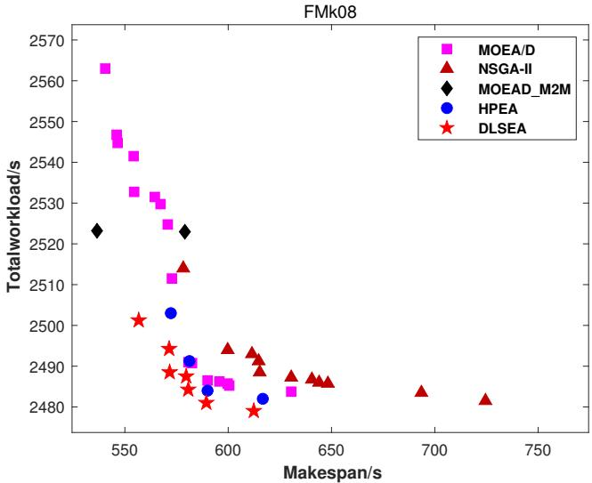
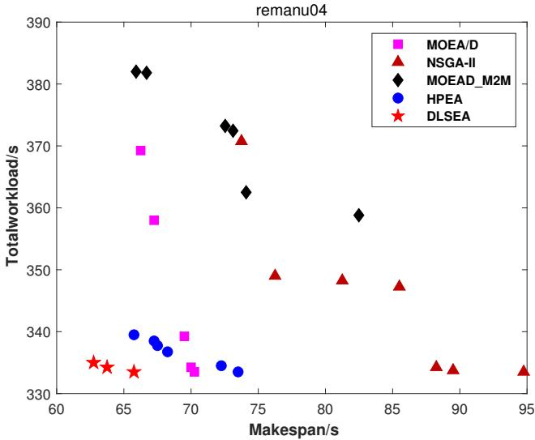
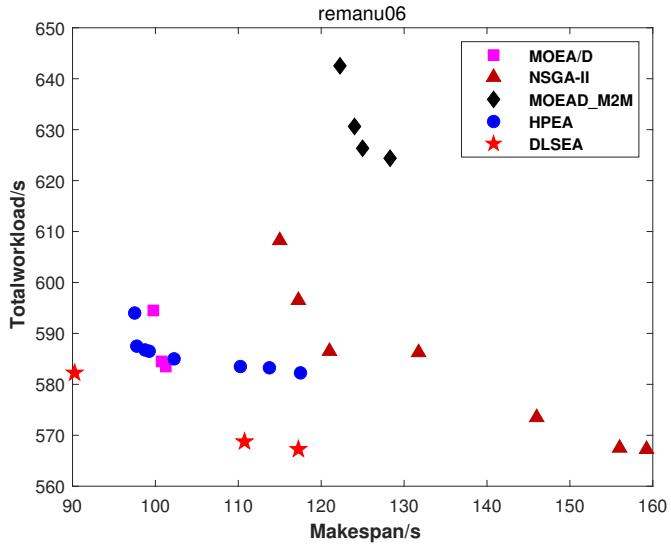
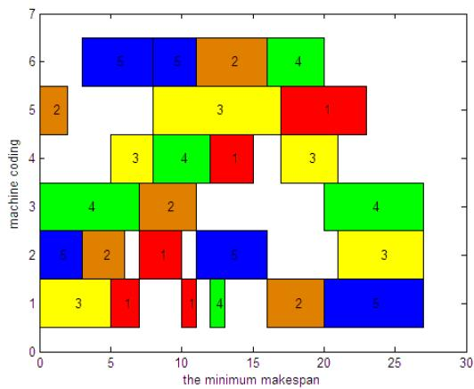
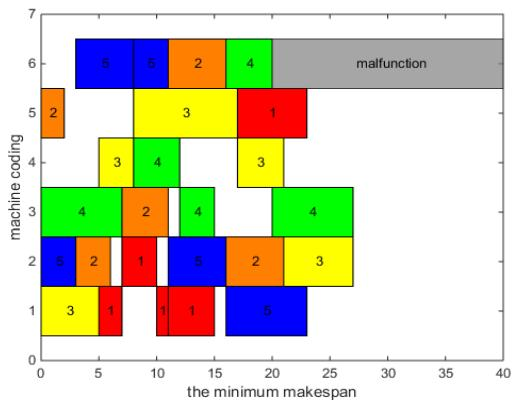
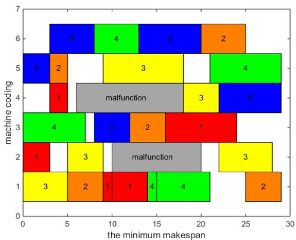
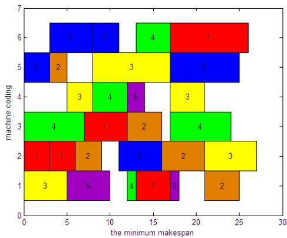
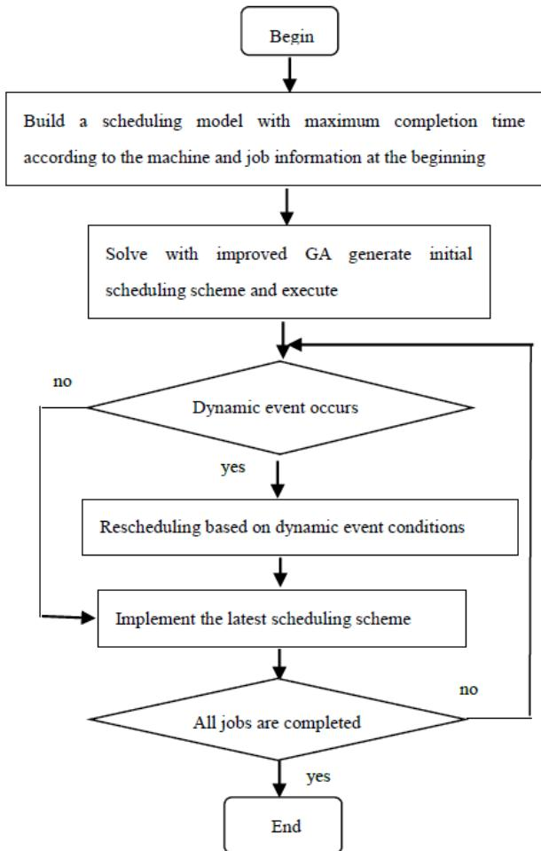
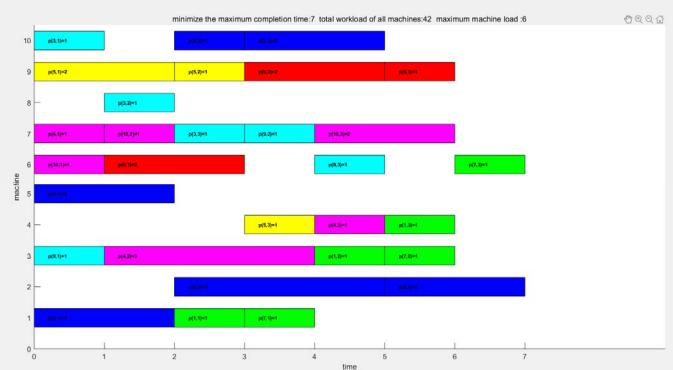
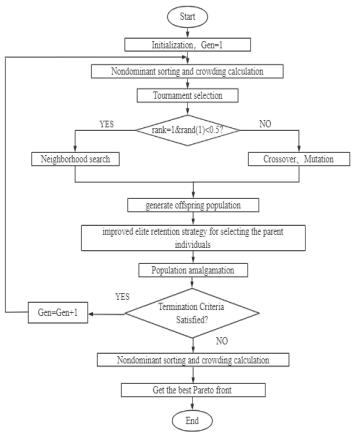

# 论文创新点总结

| 序号 | 论文 | 核心创新点 |
| ---- | ---- | ---------- |
| 1 | [一种使用 NSGA-II 的仿真启发式方法求解双目标随机柔性作业车间调度问题](#一种使用 NSGA-II 的仿真启发式方法求解双目标随机柔性作业车间调度问题) | ① 提出**仿真启发式（simheuristic）框架**：将 NSGA-II 与蒙特卡洛仿真相结合，求解加工时间随机的双目标 FJSP；② 设计**实数统一编码**（整数部分=机器索引、小数部分=工序优先级），用一个实数同时编码机器选择与工序排序两个子问题；③ **混合初始化**：6 种调度规则 + 随机生成，兼顾初始解质量与种群多样性 |
| 2 | [带运输约束的节能型柔性作业车间调度问题的多目标优化](#带运输约束的节能型柔性作业车间调度问题的多目标优化) | ① 交叉算子**借鉴 PSO 信息共享机制**，引入引导个体与自适应学习因子 k₁、k₂；② 用**改进模拟退火算法**替代传统 GA 变异算子，提出基于 Hill 函数的新退火速率，增强跳出局部最优能力；③ 双层基因串编码（机器基因串 + 工序基因串） |
| 3 | [基于帕累托的求解柔性作业车间调度问题的混合多目标进化算法](#基于帕累托的求解柔性作业车间调度问题的混合多目标进化算法) | ① 提出**混合进化算法框架**：进化算法全局搜索 + 爬山法局部搜索，更快收敛；② 采用**妥协规划（compromise programming / 全局准则法）**代替加权法求解多目标，比传统加权法更合理；③ 验证局部搜索（爬山法）相较单纯进化算法的改进效果 |
| 4 | [MOEA/D：一种基于分解的多目标进化算法](#MOEA/D：一种基于分解的多目标进化算法) | ① 提出**基于分解的多目标进化框架**：将多目标问题显式分解为 N 个标量子问题并同时优化，无需支配排序/拥挤距离；② 每个子问题**仅利用邻近子问题的信息**，降低每代计算复杂度；③ **邻域由权向量几何距离决定**，无需最优解先验知识；④ 研究三种分解方法（加权和/切比雪夫/PBI），并通过目标归一化处理尺度差异目标 |
| 5 | [求解模糊柔性作业车间调度问题的局部搜索增强多目标进化算法](#求解模糊柔性作业车间调度问题的局部搜索增强多目标进化算法) | ① 提出**双归一化策略**：两个协同进化子种群分别采用两种不同归一化方法，缓解单一归一化导致的目标尺度失衡；② 设计**自适应局部搜索**：按算子历史成功率/失败率以轮盘赌自适应选择算子，且推迟到迭代后期触发，先全局探索后局部精修；③ 将基于分解的 MOEA/D 思想应用于带三角模糊加工时间的多目标 FJSP |
| 6 | [求解动态柔性作业车间调度问题的多步遗传算法](#求解动态柔性作业车间调度问题的多步遗传算法) | ① 引入**差分进化（DE）变异操作**（结合 DE/rand/1/bin 与 DE/best/1/bin），增强种群多样性；② 设计**特殊解码方法（排序解码/随机键思想）**，保证实数变异后的个体仍是合法工序排列；③ 采用**随机位交叉 + 随机配对竞争选择**（具备精英保留能力）；④ 系统研究三类动态调度策略（周期性重调度、急单重调度、机器故障重调度） |
| 7 | [改进 NSGA2 算法求解多目标柔性作业车间调度问题](#改进 NSGA2 算法求解多目标柔性作业车间调度问题) | ① 改进子代生成：按"**非支配排序等级 + 随机概率**"分流邻域搜索与交叉变异，平衡局部/全局搜索；② 改进精英保留：提出"**精英保留 + 随机保留**"相结合，用随机性增强种群多样性、避免陷入局部最优 |


# 一种使用 NSGA-II 的仿真启发式方法求解双目标随机柔性作业车间调度问题

## 一、文章信息

- **题目**：A simheuristic approach using the NSGA-II to solve a bi-objective stochastic flexible job shop problem（一种使用 NSGA-II 的仿真启发式方法求解双目标随机柔性作业车间调度问题）
- **作者**：Camilo Andrés Rodríguez-Espinosa、Eliana María González-Neira、Gabriel Mauricio Zambrano-Rey
- **单位**：哥伦比亚波哥大 哈维里亚纳天主教大学 工学院 工业工程系（Departamento de Ingeniería Industrial, Facultad de Ingeniería, Pontificia Universidad Javeriana, Bogotá, Colombia）
- **期刊**：*Journal of Simulation*（《仿真期刊》），2024 年第 18 卷第 4 期，646–670 页；在线发表于 2023 年 7 月 5 日；DOI: 10.1080/17477778.2023.2231877（Taylor & Francis 出版，© 2023 The Operational Research Society）

## 二、背景、目的、结论

### 2.1 背景

柔性作业车间调度（FJSS）是作业车间调度（JSS）的推广——每道工序可在多台机器中选择加工，属于 NP-hard 组合优化问题，广泛应用于化工、航空、半导体、炼钢等行业。由于不完全加工时间存储成本、迟交罚款等原因，遵循准时制生产（JIT）理念，以最小化"提前/拖期之和（Earliness + Tardiness）"为核心目标。为使模型更贴近现实，文中考虑加工时间不确定（随机）这一随机因素，并采用预测式（predicive）调度思路，引入稳健性度量 "Earliness+Tardiness Risk"，以保证预测性的排产在随机扰动下仍保持较好性能。

### 2.2 目的

针对加工时间随机的双目标柔性作业车间调度问题，同时优化两个相互冲突的目标：
1. 最小化确定性环境下的提前/拖期之和（Earliness + Tardiness）；
2. 最小化"提前/拖期风险"（Earliness+Tardiness Risk），以在不确定环境下获得稳健解。

为此，提出一种**仿真启发式算法（simheuristic）**：将**非支配排序遗传算法（NSGA-II）**与**蒙特卡洛（Monte Carlo）**仿真相结合，以求得两个目标函数的帕累托（Pareto）前沿。

### 2.3 结论

所提仿真启发式算法有效求解了该双目标随机柔性作业车间调度问题，主要结论包括：

- **对比混合整数线性规划（MILP）模型**：仿真启发式在计算成本上优于对 MILP 解进行仿真的方法，能以更短时间获得更优（虽未必最优）的结果。
- **对比分派规则（EDD、SPT、LPT、CR、AVPRO、S/RO）**：仿真启发式平均将 Earliness+Tardiness 至少提升约 **55%**，将 Earliness+Tardiness Risk 至少提升约 **15%**。
- **对比确定性单目标遗传算法**：仿真启发式将 Earliness+Tardiness Risk 至少改进约 **69%**。
- **变异系数与概率分布的影响**：变异系数对两个目标函数及多数性能指标具有显著影响；在 100% 变异系数下，指数分布与对数正态分布之间存在显著差异（指数分布在除 diversity 外的指标上表现更好）。

作者强调：结果体现了将随机性纳入决策过程以及进行准确的分布拟合的重要性。未来研究方向包括采集真实 FJSS 数据进行分布拟合、加入更多随机因素（机器故障、返工、可用时间变化等）、测试其他概率分布（Gamma、Weibull）、以及与其他元启发式（禁忌搜索、PSO、迭代局部搜索等）或其他仿真范式（离散事件、agent-based）混合验证。

## 三、结果


## 四、实验方法

### 4.1 染色体设计（4.1 节）

#### 4.1.1 设计思想

基于 L. Sun et al. (2019) 的实数编码方式，将 **机器选择** 和 **工序优先级** 两个决策信息融合到一个实数中。染色体表示为一个 **二维矩阵**：

- **行**：作业（Job），记为 J1, J2, ..., Jn
- **列**：工序编号（Operation），记为 O1, O2, ..., Om

矩阵中的每个元素为一个 **实数**，其结构为：

    整数部分 k + 小数部分 f，其中 f ∈ [0, 1)

- 整数部分 k：机器索引
- 小数部分 f：工序优先级

#### 4.1.2 整数部分：机器选择

- **含义**：整数部分 k 表示该工序在其 **可加工机器集合 Mij** 中的索引（从 0 开始计数）。
- **取值范围**：0 ≤ k ≤ |Mij| - 1
- **解码规则**：
  - k = 0 → 选择 Mij 中第 1 台机器
  - k = 1 → 选择 Mij 中第 2 台机器
  - ……
  - k = |Mij| - 1 → 选择 Mij 中最后一台机器

**关键性质**：

- 不同工序的 Mij 大小 **不一定相同**，因此整数部分的取值范围因工序而异。
- 同样的整数值在不同工序中可能对应不同的机器。
- 该设计天然保证机器分配的可行性。

#### 4.1.3 小数部分：工序优先级

- **含义**：小数部分 f ∈ [0, 1) 表示该工序在同级可调度工序中的 **相对优先级**。
- **解码规则**：
  - 在解码的每一步，对于所有当前可调度的工序（其前序工序已完成），比较它们的小数部分。
  - **小数部分越大，优先级越高**，越先被安排加工。

**关键性质**：

- 优先级是动态的，随调度进展不断变化。
- 小数部分只影响同一作业内已解锁工序之间的竞争，不会破坏工序顺序约束。

#### 4.1.4 染色体示例（论文图3）

|      | O1   | O2   | O3   |
| ---- | ---- | ---- | ---- |
| J1   | 2.88 | 0.19 | 1.83 |
| J2   | 0.28 | 0.22 | 1.43 |
| J3   | 0.80 | 2.44 | —    |

以 O11 = 2.88 为例：

- 整数部分 2：M11 = {M1, M2, M3}，索引 2 → 选择 M3
- 小数部分 0.88：优先级为 0.88

#### 4.1.5 设计优点

| 优点         | 说明                                               |
| ------------ | -------------------------------------------------- |
| 紧凑性       | 每个工序只需一个实数，**减少染色体长度和变量数量** |
| 可行性保证   | 整数部分范围限定在                                 |
| 灵活性       | 小数部分优先级可动态调整                           |
| 易于遗传操作 | 交叉、变异操作简单，且解码过程时间复杂度低         |
| 统一编码     | **机器分配和工序排序两个子问题统一在一个染色体中** |

### 4.2 初始种群生成（4.2 节）

#### 4.2.1 总体策略

初始种群采用 **混合策略** 生成：

> **一部分个体用 6 种调度规则生成；剩余个体完全随机生成。**

- 6 种调度规则 = 3 种静态规则 + 3 种动态规则
- 目的：兼顾 **初始解质量** 与 **种群多样性**，加速 NSGA-II 收敛。

#### 4.2.2 生成解的核心逻辑（逐步调度）

生成一个完整调度的过程是 **逐步调度**，每一步做两件事：

**第一步：为每个作业选择候选机器**

对每个作业当前待加工工序 (i, j)：

1. 计算每台可加工机器 m ∈ Mij 的 **可用时间**。
2. 选择 **可用时间最小** 的机器。
3. 若并列，选择 **加工时间 PTijm 最小** 的机器。
4. 若仍并列，**随机选一台**。

**第二步：从所有作业中选一个来加工**

1. 计算每个作业的 **最早可用时间**（= max(上一道工序完工时间, 候选机器可用时间)）。
2. 选择 **最早可用时间最小** 的作业。
3. 若并列，用 6 种调度规则之一打破平局。
4. 若仍并列，**随机选一个**。

#### 4.2.3 六种调度规则

**静态规则（不随调度过程变化）**

| 规则 | 全称                     | 选择依据   | 含义             |
| ---- | ------------------------ | ---------- | ---------------- |
| EDD  | Earliest Due Date        | 最小 EWi   | 交货期最紧的优先 |
| SPT  | Shortest Processing Time | 最小 PTijm | 加工最快的优先   |
| LPT  | Longest Processing Time  | 最大 PTijm | 加工最慢的优先   |

**动态规则（依赖当前调度状态）**

**CR（Critical Ratio，临界比）**，式(23)：

    CRi = max( (SWi - STij) / Σ_{h=1}^{j} PTihm_bar , 0 )

- 选 CRi 最小的作业。
- CRi < 1 表示时间紧迫，需优先加工。

**AVPRO（Average Processing Time per Operation）**，式(24)：

    APi = ( Σ_{h=j}^{|Ii|} PTihm_bar ) / ( |Ii| - j + 1 )

- 选 APi 最小的作业。
- 剩余工序平均加工时间越短越优先。

**S/RO（Slack per Remaining Operations）**，式(25)：

    SRi = max( SWi - CTi(j-1) , 0 ) / ( |Ii| - j + 1 )

- 选 SRi 最小的作业。
- 每道剩余工序平均松弛时间越小越紧急。

#### 4.2.4 生成解的完整流程

    1. 初始化：所有作业当前工序 j=1，所有机器可用时间=0。
    
    2. 重复直到所有工序调度完毕：
       a. 对每个未完成作业 i：
          - 选候选机器（最早可用 → 加工时间最小 → 随机破平局）
          - 计算最早可用时间
       b. 从所有作业中选最早可用时间最小者
          - 并列 → 调度规则破平局 → 随机
       c. 安排该工序：
          - 开始时间 = max(作业上一道工序完工, 机器可用时间)
          - 完工时间 = 开始时间 + 加工时间
          - 更新机器可用时间和作业当前工序
    
    3. 所有工序调度完毕，得到一个初始解。

#### 4.2.5 反向编码成染色体

调度方案生成后，需反向编码：

- **整数部分**：记录每道工序选的机器在 Mij 中的索引。
- **小数部分**：按调度顺序归一化到 [0, 1)，越早调度小数部分越大。

**示例**：若总工序数为 8，调度顺序为第 r 个，则小数部分可取 (8 - r) / 8。

#### 4.2.6 初始种群组成（示意）

设种群规模 N = 1000：

| 来源     | 数量（示意） |
| -------- | ------------ |
| EDD      | ~100         |
| SPT      | ~100         |
| LPT      | ~100         |
| CR       | ~100         |
| AVPRO    | ~100         |
| S/RO     | ~100         |
| 随机生成 | ~400         |

> 论文未明确给出每种规则的具体数量，以上为示意。

#### 4.2.7 设计优点

- **质量**：调度规则体现领域知识，生成较优初始解。
- **多样性**：**6 种规则从不同角度生成解，随机解补充探索空间。**
- **加速收敛**：好的起点使 NSGA-II 更快逼近 Pareto 前沿。
- **避免偏差**：随机解防止种群过早收敛到局部最优。

### 4.3 交叉操作（4.4 节）

#### 4.3.1 交叉方式

采用 **基于位置的概率交叉**（均匀交叉的变体）：

1. 对染色体的 **每个位置** 生成一个 [0, 1] 的随机数。
2. 若随机数 < 交叉概率 Pc，子代取 **父代1** 的基因。
3. 否则，子代取 **父代2** 的基因。

#### 4.3.2 示例（论文图5）

- 黄色：父代染色体
- 红色：子代染色体
- 每个基因独立选择来自父代1还是父代2

#### 4.3.3 交叉后的甘特图（论文图6）

交叉生成的子代解码后得到新调度，论文示例中 ET = 1。

#### 4.3.4 与拥挤度距离的关系

- 在非支配排序后，每个 Pareto 前沿内的染色体按 **拥挤度距离** 排序。
- **拥挤度距离越大**，表示该解周围越稀疏，越应保留以维持多样性。
- 前沿两端的解拥挤度距离设为 ∞。
- 选择交叉父代时，优先选择拥挤度大的解，促进 **探索**。

#### 4.3.5 选择与更新流程

1. 从当前种群中随机选一对染色体进行交叉，生成 Q 个子代。
2. 得到规模为 N + Q 的混合种群。
3. 对混合种群进行 **快速非支配排序** 和 **拥挤度距离** 计算。
4. 保留前 N 个染色体作为下一代种群。
5. 重复直到满足停止准则。

#### 4.3.6 参数设置

| 参数        | 值   |
| ----------- | ---- |
| 种群规模 N  | 1000 |
| 子代数量 Q  | 500  |
| 交叉概率 Pc | 30%  |
| 迭代代数    | 750  |

### 4.4 变异操作（4.5 节）

#### 4.4.1 变异方式

1. 对每个染色体生成一个 [0, 1] 的随机数。
2. 若随机数 < 变异概率 Pm，则对该染色体执行变异。
3. **变异操作**：选择染色体中的 **某一个作业**，**反转其小数部分的顺序**。

#### 4.4.2 示例（论文图7）

**变异前**：

|      | O1   | O2   | O3   |
| ---- | ---- | ---- | ---- |
| J1   | 2.88 | 0.19 | 2.47 |
| J2   | 1.38 | 0.22 | 1.43 |
| J3   | 0.33 | 2.44 | —    |

选择 J3 进行变异，反转其小数部分顺序：

**变异后**：

|      | O1   | O2   | O3   |
| ---- | ---- | ---- | ---- |
| J1   | 2.88 | 0.19 | 2.47 |
| J2   | 1.38 | 0.22 | 1.43 |
| J3   | 0.44 | 2.33 | —    |

- J3, O1：0.33 → 0.44
- J3, O2：2.44 → 2.33

注意：**整数部分不变**（机器选择不变），只改变 **小数部分**（优先级）。

#### 4.4.3 变异后的甘特图（论文图8）

变异后的子代解码得到新调度，论文示例中 ET = 3。

#### 4.4.4 变异的意义

- **保持机器选择多样性**：整数部分不变，机器分配方案不变。
- **改变工序优先级**：通过反转小数部分，改变同一作业内工序的调度顺序。
- **局部搜索**：变异是对解的小扰动，有助于跳出局部最优。
- **参数设置**：变异概率 Pm = 2.5%（论文表4）。

### 4.5 设计要点回顾

1. **编码紧凑**：一个实数同时编码机器和优先级，减少变量数量。
2. **可行性保证**：整数部分范围限定在 |Mij| 内，解码天然可行。
3. **动态优先级**：小数部分在解码过程中动态比较，适应性强。
4. **混合初始化**：调度规则保证质量，随机解保证多样性。
5. **均匀交叉**：每个基因独立选择父代，保持种群多样性。
6. **局部变异**：反转作业内小数部分，微调优先级而不改变机器选择。
7. **精英保留**：通过非支配排序 + 拥挤度距离，保留优质解并维持多样性。

## 五、自我想法

* 从各个角度生成初始解能够丰富种群多样性


# 带运输约束的节能型柔性作业车间调度问题的多目标优化

## 一、文章信息

- **题目**：Multi-objective optimization for energy-efficient flexible job shop scheduling problem with transportation constraints（带运输约束的节能型柔性作业车间调度问题的多目标优化）
- **作者**：Dai Min（戴敏，通讯作者）、Tang Dunbing（唐敦兵）、Giret Adriana、Salido Miguel A.
- **单位**：
  - Dai Min：扬州大学机械工程学院（College of Mechanical Engineering, Yangzhou University），江苏扬州
  - Tang Dunbing：南京航空航天大学机电学院（College of Mechanical and Electrical Engineering, Nanjing University of Aeronautics and Astronautics），南京
  - Giret Adriana、Salido Miguel A.：西班牙瓦伦西亚理工大学 信息系统与计算系/AI2（Departamento de Sistemas Informáticos y Computación/AI2, Universitat Politècnica de València），瓦伦西亚
- **期刊**：*Robotics and Computer-Integrated Manufacturing*（《机器人与计算机集成制造》），2019 年第 59 卷，143–157 页；DOI: 10.1016/j.rcim.2019.04.006（Elsevier，© 2019 Elsevier Ltd.）

## 二、背景、目的、结论

### 2.1 背景

制造业面临因能源消耗及其环境影响所带来的巨大经济和环保压力。据国际能源展望，2012 年工业部门消耗了全球约 54% 的能源，且能耗逐年增长；中国制造业消耗了全国一半以上的电力并产生大量 CO₂ 排放。相比在机器层、产品层进行节能改造（投资大），从生产管理层采用**智能调度/节能调度**是中小型企业更可行的节能策略。然而，以往节能调度研究大多只关注加工环节的能耗，而**忽略了 AGV 等运输资源在工作间转运件所产生的运输能耗**。实际生产中加工与运输存在强烈耦合：工序的机器选择会影响 AGV 的运输时间，运输时间又会导致机器等待，运输环节本身也会产生可观能耗。因此，**本文在柔性作业车间调度中引入运输约束，同时优化加工与运输，研究总能耗最小化问题。**

### 2.2 目的

针对**带运输约束的节能型柔性作业车间调度问题（EFJSP）**，建立将**总能耗与制造周期（makespan）同时最小化**的多目标优化模型，并开发一种**增强型遗传算法（Enhanced Genetic Algorithm, EGA）** 求解该 NP-hard 问题，以获得能耗与工期之间的帕累托最优解。

### 2.3 结论

1. **模型与算法有效**：提出的节能型柔性作业车间调度模型与增强遗传算法（EGA）能有效、高效地求解该问题；EGA 在 HV（超体积）和 IGD（反向世代距离）两个综合指标上均优于普通多目标遗传算法（MOGA），在小、中、大（20×20、50×50、80×50）规模算例上都能获得收敛性和分布性更好、数量更多、质量更高的帕累托解。
2. **目标之间存在冲突**：makespan 与总能耗呈相互制约的冲突关系，需在两者之间权衡。
3. **运输能耗不可忽视**：运输能耗对总能耗有不可忽略的影响。运输时间越长，makespan 和总能耗越高，运输环节能耗占比越大；当运输时间高于加工时间时，还会直接影响机器的选择和各工序的加工顺序，因此合理的车间布局和缩短运输时间是一种有效的节能调度策略。
4. **未来工作**：进一步提升模型精度与计算效率；考虑机器故障、急单、撤单等实际动态事件；并研究动态调度环境下的节能问题。

## 三、结果


## 四、实验方法

### 4.1 染色体编码

每条染色体由两层基因串组成，总长度为：

$$
L = 2 \times \sum_{i=1}^{n} N_i
$$

其中 $N_i$ 为工件 $J_i$ 的工序数。

| 层次   | 名称                                | 含义                                                         |
| ------ | ----------------------------------- | ------------------------------------------------------------ |
| 第一层 | 机器基因串（machine gene-string）   | 每个基因表示对应工序在其可选机器集合中的索引                 |
| 第二层 | 工序基因串（operation gene-string） | 基于工序的编码，同一工件编号第 $p$ 次出现表示该工件第 $p$ 道工序 |

**示例**（3 工件、5 机器、共 8 道工序，$L = 16$）：

- 机器基因串 C1：`2 3 5 3 4 1 4 3`
- 工序基因串 C2：`1 3 2 1 3 3 2 1`

### 4.2 交叉操作

EGA 的交叉算子借鉴了 **PSO 的信息共享机制**：先根据非支配排序和拥挤距离选出**引导个体（guided individual）**，再让父代向引导个体和另一父代学习。引入两个**自适应学习因子** $k_1$、$k_2$：

- $k_1$：向引导个体学习的比例；
- $k_2$：向另一父代学习的比例。

交叉操作分两层分别进行。

#### 4.2.1 机器基因串的交叉

**符号说明**

| 符号     | 含义                   |
| -------- | ---------------------- |
| G1       | 机器基因串层的引导个体 |
| P11、P21 | 两个父代个体           |
| O11      | 最终子代               |
| O11′     | 含空位“0”的中间个体    |
| L        | 机器基因串长度         |

**步骤**

**Step 1**：确定引导个体 G1 和父代 P11、P21。

**Step 2**：生成位置集合 A 和 B

- 从 G1 中随机选择 $L/2 \times k_1$ 个位置，构成集合 A；
- 从 P21 中随机选择 $L/2 \times k_2$ 个位置（**排除集合 A 中的位置**），构成集合 B。

**Step 3**：生成中间个体 O11′

- 将 G1 中集合 A 对应位置的基因，按顺序复制到 O11′ 的对应位置；
- 将 P21 中集合 B 对应位置的基因，按顺序复制到 O11′ 的对应位置；
- 其余位置置为“0”，表示空位。

**Step 4**：填充空位，得到最终子代 O11

- 从左到右检查 O11′ 中的空位；
- 依次用父代 P11 中对应位置的基因填充这些空位；
- 得到完整的子代 O11。

**核心思想**：**子代 = 一部分来自引导个体 G1 + 一部分来自另一父代 P21 + 剩余部分来自自身父代 P11。**

#### 4.2.2 工序基因串的交叉

**符号说明**

| 符号       | 含义                                    |
| ---------- | --------------------------------------- |
| G2         | 工序基因串层的引导个体                  |
| P12、P22   | 两个父代个体                            |
| P12′、P22′ | 父代中集合 C 对应位置置“0”后的个体      |
| P12″       | 父代 P12 中集合 D 对应位置置“0”后的个体 |
| O12′、O12″ | 中间个体                                |
| O12        | 最终子代                                |

**步骤**

**Step 1**：确定引导个体 G2 和父代 P12、P22。

**Step 2**：从 G2 和 P22 生成中间个体 O12′

- 随机选择 $L/2 \times k_1$ 个位置，构成集合 C；
- 将 G2 中集合 C 对应位置的基因复制到 O12′ 的对应位置；
- 将 P12、P22 中集合 C 对应位置的基因置为“0”，得到 P12′、P22′；

**Step 3**：从 P22′ 和 P12′  生成中间个体 O12″

- 在 **P22′ 的非空位置**中，随机选择 $L/2 \times k_2$ 个位置，构成集合 D；
- 将 P22′ 中集合 D 对应位置的基因，**复制到 O12″ 的相同位置**；
- 将 P12′  中集合 D 对应位置置为“0”，得到 P12″。

**Step 4**：填充空位，得到最终子代 O12

- 将 P12″ 中剩余的非空基因，按顺序依次填入 O12″ 的空位；
- 得到完整的子代 O12。

**注意事项**：

- 集合 D 是在 **P22′ 的非空位置**中选的，不是在空位中选；
- 复制到 O12″ 时是**复制到与集合 D 相同的位置**，不是随机空位；
- 从 P12 填充基因时，是**按从左到右顺序填入第一个空位**，不是随机选空位；
- **论文图 5 中 O12″ 的标绿基因位置（第 6、8 位）与正文 Step 3 描述不一致，应以正文算法描述为准。**

### 4.3 变异操作

EGA 用**改进的模拟退火算法（SAA）**替代传统 GA 的变异算子，以增强局部搜索能力、避免早熟收敛。变异操作包含三个模块：

#### 4.3.1 状态生成函数

用于从当前个体生成一个新个体（邻域解）。

**机器基因串**：

- Step 1：随机选择若干个位置；
- Step 2：将这些位置的基因值改为对应工序可选机器集合中的其他机器编号。

**工序基因串**：

- Step 1：随机选择两个位置；
- Step 2：交换这两个位置的基因元素。

#### 4.3.2 接受概率模块

基于 Boltzmann 函数定义劣解的接受概率：

$$
p(i \rightarrow j) =
\begin{cases}
1, & F(i) \geq F(j) \\
\exp\left(\dfrac{F(i) - F(j)}{T}\right), & F(i) < F(j)
\end{cases}
$$

其中：

- $F(i)$：新状态的目标函数值；
- $F(j)$：当前状态的目标函数值；
- $T$：当前温度。

#### 4.3.3 退火速率模块

**传统退火速率函数**：
$$
T(t) = k \times T(t-1)
$$

其中 $k \in (0,1)$，通常取 0.75–0.95。

**EGA 提出的新退火速率函数（基于 Hill 函数）**：

$$
T(t) = k \times \frac{T_0^n}{T_0^n + t^n}
$$

其中：

- $T_0$：温度阈值，与初始温度相关；
- $n$：Hill 系数；
- $t$：迭代次数。

**优势**：新退火速率函数具有更高的劣解接受概率，能有效跳出局部最优，避免早熟收敛。


可以看出改进后的退火速率函数更平滑。

### 4.4 EGA 整体流程

见论文算法1


## 五、自我想法

* 对于传统的EA算法，可以融合其他类似的算法，如PSO、蚁群、灰狼等
* 融合模拟退火，以一定概率接收较差的解


# 基于帕累托的求解柔性作业车间调度问题的混合多目标进化算法

## 一、文章信息

- **题目**：Pareto-based Hybrid Multi-Objective Evolutionary Algorithm for Flexible Job-shop Scheduling Problem（基于帕累托的求解柔性作业车间调度问题的混合多目标进化算法）
- **作者**：
  1. M. Nagamani（第一作者），马德拉斯大学 Presidency College 研究学者（Research Scholar），金奈
  2. Dr. E. Chandrasekaran，Presidency College 数学副教授，金奈
  3. Dr. D. Saravanan，Karpaga Vinayaga 工程技术学院 数学教授，金奈
- **单位**：印度金奈（Chennai）——Presidency College（University of Madras）及 Karpaga Vinayaga College of Engineering and Technology
- **期刊**：*IOSR Journal of Mathematics (IOSR-JM)*，第 9 卷第 1 期（2013 年 11–12 月），36–45 页（e-ISSN: 2278-5728, p-ISSN: 2319-765X）

## 二、背景、目的、结论

### 2.1 背景

作业车间调度问题（JSP）是组合优化中最困难的问题之一，属 NP-hard；柔性作业车间调度问题（FJSP）是经典 JSP 的推广，允许一道工序在多台可选机器中择一加工，因此更贴近实际制造（如柔性制造系统）。FJSP 可分为两个子问题：**路径子问题**（将工序分配到机器）和**排序子问题**（在各机器上对已分配工序排序）。与单目标 FJSP 相比，多目标 FJSP 的研究仍较少，且多数传统方法只使用单一优化算法，或将多个冲突目标通过加权法合并。由于**各目标（makespan、最大机器负载、总机器负载）之间存在冲突，需要一种更合理的多目标处理方法，并借助局部搜索提高解的质量**。

### 2.2 目的

针对柔性作业车间调度问题，同时优化三个相互冲突的目标：
1. 最小化 makespan（完工时间）；
2. 最小化最大机器负载（关键机器的工作负荷）；
3. 最小化所有机器的总负载。

提出一种**混合多目标进化算法（hybrid evolutionary algorithm）**：以**进化算法进行全局搜索**，以**爬山法（hill climbing）进行局部搜索**，并采用**扰动全局准则（compromise programming / 妥协规划）方法**代替常用的加权法来引导搜索方向，从而在合理运行时间内获得大量帕累托最优解。

### 2.3 结论

1. **算法有效**：所提混合进化算法能有效求解多目标柔性作业车间调度问题，在 4×5、8×8、10×10、15×10 四个代表性算例上均取得良好结果，相较于已有文献算法表现出更优性能。
2. **混合策略优势**：进化算法负责全局搜索，爬山法负责局部搜索；先由 EA 得到初始解，再由爬山法进行邻域搜索改进。与仅用进化算法相比，混合算法能在更少的迭代次数内达到可接受的解。
3. **方法贡献**：
   - 提出求解最小化 makespan、总机器负载、最大机器负载三目标 FJSP 的混合算法；
   - 采用借鉴妥协规划（compromise programming）的方法求解多目标 FJSP，且实验表明该方法比传统加权法更合理；
   - 验证了局部搜索（爬山法）相比单纯进化算法的改进效果。
4. **局限与后续**：文中局部搜索（爬山法）的邻域仅改变各机器上的作业顺序，因此主要改进 makespan，而不影响 Max WL 和总负载 ∑WL；对未来研究和进一步扩展做了展望。

## 三、结果


## 四、实验方法

### 4.1 交叉操作

交叉操作对 **A-string 和 B-string 分别独立进行**，方法不同。

#### 4.1.1 A-string 交叉（两点交叉）

- **操作对象**：机器分配向量
- **方法**：随机选择两个位置，交换两个父代在这两个位置之间的整个子串
- **特点**：通用的两点交叉，用于探索不同的机器分配组合，**不是 POX**
- **作用**：探索机器组合

#### 4.1.2 B-string 交叉（POX 交叉）

- **操作对象**：工序排序向量
- **方法**：
  1. 将所有工件随机分成两组 J1 和 J2；
  2. 子代 1 保留父代 1 中属于 J1 的工件，保持原位置不变；
  3. 子代 2 保留父代 2 中属于 J2 的工件，保持原位置不变；
  4. 空位分别用另一父代中属于另一组的工件按原顺序依次填入。
- **特点**：本质上是 **POX（Precedence Operation Crossover）**，以工件为单位交叉，保留部分工件位置，其余按顺序填充，**自动保证子代可行性**
- **作用**：继承父代的工序顺序信息

### 4.2 变异操作

论文中**只对 B-string 进行变异**，A-string 不参与变异。

#### 4.2.1 变异步骤

1. 随机生成两个位置；
2. 将 B-string 在这两个位置之间的子串进行**反转**；
3. 得到新的 B-string。

#### 4.2.2 变异特点

- **变异概率小**（论文中取 0.1）；
- 防止算法陷入局部最优；
- 维持种群多样性；
- 只改变工序顺序，不改变机器分配；
- 操作简单，计算量小。

### 4.3 爬山操作

爬山法嵌入在 EA 之后，对每个染色体进行局部精修。

#### 4.3.1 邻域定义

> **改变每台机器上已分配工件的加工顺序**

即：

- **不改变 A-string**（机器分配不变）；
- **只改变 B-string**（工序排序）；
- 通过交换、插入、反转等操作生成邻居。

#### 4.3.2 搜索策略

采用**最陡上升爬山法（Steepest Ascent Hill Climbing）**：

1. 生成当前解的所有邻居；
2. 比较所有邻居的 makespan；
3. 选择 makespan 最小的邻居；
4. 如果比当前解更好，就移动过去，重复；
5. 如果邻域中没有更好的解，就停止。

#### 4.3.3 优化目标

- **只能改善 makespan（Cmax）**；
- **不能改变 Max WL 和 ΣWL**（因为机器分配不变）。

### 4.4 三者在整体流程中的位置

```
Step 1. 随机生成初始种群（A-string + B-string）
                ↓
Step 2. 计算 Cmax、Max WL、ΣWL，用全局准则法评估适应度
                ↓
Step 3. 交叉 + 变异，生成新种群
        - A-string：两点交叉
        - B-string：POX 交叉
        - B-string：反转变异
                ↓
Step 4. 对每个染色体执行爬山法局部搜索
        - 邻域：只改变工序顺序
        - 策略：最陡上升
        - 目标：仅优化 makespan
                ↓
Step 5. 提取最佳适应度
                ↓
Step 6. 判断终止条件，未满足则继续迭代
                ↓
Step 7. 输出最优解
```

### 4.5 关键要点总结

| 项目           | 内容                                       |
| -------------- | ------------------------------------------ |
| 编码方式       | A-string（机器分配）+ B-string（工序排序） |
| A-string 交叉  | 两点交叉                                   |
| B-string 交叉  | POX 交叉                                   |
| 变异           | 只对 B-string 反转变异                     |
| 变异概率       | 0.1                                        |
| 爬山法邻域     | 改变工序顺序，不改变机器分配               |
| 爬山法策略     | 最陡上升（枚举所有邻居，选最优）           |
| 爬山法优化目标 | 仅 makespan                                |
| 交叉作用       | 探索新解（机器组合 + 工序顺序）            |
| 变异作用       | 维持多样性，防止局部最优                   |
| 爬山作用       | 局部精修，加速收敛                         |

## 五、自我想法

* 多目标融合成单目标优化
* 对于遗传算法生成的解，探索其邻域的解是否存在更好的，加强局部搜索


# MOEA/D：一种基于分解的多目标进化算法

## 一、文章信息

- **题目**：MOEA/D: A Multiobjective Evolutionary Algorithm Based on Decomposition（MOEA/D：一种基于分解的多目标进化算法）
- **作者**：Qingfu Zhang（张清福，IEEE 高级会员）和 Hui Li（李辉）
- **单位**：英国埃塞克斯大学 计算机科学系（Department of Computer Science, University of Essex, Wivenhoe Park, Colchester, UK）
- **期刊**：*IEEE Transactions on Evolutionary Computation*，第 11 卷第 6 期，2007 年 12 月，712–731 页；DOI: 10.1109/TEVC.2007.892759

## 二、背景、目的、结论

### 2.1 背景

**多目标优化问题（MOP）的各目标常相互冲突，需在目标间权衡，并以帕累托最优定义最佳折中**。决策者需要的是沿帕累托前沿（PF）均匀分布、数量适中、具有代表性的帕累托解集。传统多目标优化的基本策略是"分解"（**将多目标问题分解为若干标量子问题**），但这一思想当时在进化多目标优化中尚未被广泛采用。当时主流的 MOEA（如 NSGA-II、SPEA-II、MOGLS 等）都把 MOP 当作一个整体处理，采用基于支配关系的适应度赋值和拥挤距离等多样性维护机制，而这些机制正是非分解类 MOEA 的难点所在。

### 2.2 目的

提出一种**基于分解的多目标进化算法（MOEA/D）**：将多目标问题显式地分解为多个标量优化子问题，并**同时**优化它们；每个子问题仅利用其若干**邻近子问题**的信息进行求解，从而降低每代的计算复杂度。同时研究三种分解方法（**加权和法、切比雪夫法、边界交集法/PBI**），并将其与 MOGLS、NSGA-II 进行对比，验证该框架的可行性、效率、可扩展性及对邻域大小的敏感性。

### 2.3 结论

1. **有效性与低复杂度**：MOEA/D 将数学规划中的分解思想自然引入进化算法，每代计算复杂度低于 MOGLS 和 NSGA-II；在多目标 0–1 背包问题和连续多目标测试问题上，使用简单分解方法的 MOEA/D 优于或等同于 MOGLS 和 NSGA-II。
2. **均匀分布能力**：采用 PBI（基于惩罚的边界交集）高级分解方法的 MOEA/D，可在三目标连续测试实例上生成**非常均匀分布**的帕累托解集。
3. **处理尺度差异目标**：通过目标归一化技术，MOEA/D 能很好地处理量纲/尺度差异悬殊的目标。
4. **小种群与低代价**：MOEA/D 用小种群即可在低计算成本下获得少数且均匀分布的帕累托解。
5. **可扩展性与鲁棒性**：计算成本随决策变量数量线性增长；算法对邻域大小 的设置不敏感。
6. **方法论意义**：该框架为将数学规划领域长期研究的分解策略引入进化多目标优化提供了自然途径，新的分解方法和标量优化技术都可便捷地集成到 MOEA/D 框架中。

## 三、结果


## 四、实验方法

### 4.1 核心思想

MOEA/D 把多目标问题**分解成 $N$ 个标量子问题**，每个子问题配一个预设的权重向量 $\lambda^i$。种群中的第 $i$ 个解 $x^i$ 就是"第 $i$ 个子问题当前找到的最优解"。算法**一次性同时**优化所有子问题，而每个子问题只借用它"邻近子问题"的信息来优化自己。

> 两个不依赖问题先验知识的关键机制：
> 1. **邻域 $B(i)$ 由权重向量的几何距离决定**，与最优解无关，事前纯构造。
> 2. **Step 2.2 的改进靠计算已知的标量函数 $g^{te}$ 做局部搜索**，不需要知道全局最优。

### 4.2 每代维护的数据结构

| 符号                       | 含义                                      |
| -------------------------- | ----------------------------------------- |
| 种群 $x^1,\dots,x^N$       | $x^i$ 是第 $i$ 个子问题的当前解           |
| $FV^1,\dots,FV^N$          | $FV^i=F(x^i)$，各解的目标向量             |
| 参考点 $z=(z_1,\dots,z_m)$ | 各目标"至今最优值"（最小化时 $z_j=\min$） |
| 外部种群 $EP$              | 存储搜索中发现的非支配解（最终输出）      |

### 4.3 算法流程

**输入**：MOP、停止准则、$N$、均匀权向量 $\lambda^1,\dots,\lambda^N$、邻域大小 $T$。**输出**：$EP$。

**Step 1 初始化**
- 1.1 $EP=\emptyset$。
- 1.2 计算任意两个**权重向量**的欧氏距离，为每个 $\lambda^i$ 找最近的 $T$ 个，得到邻域 $B(i)$。
- 1.3 **随机或按问题特定方法**生成初始种群 $x^1,\dots,x^N$（不需要是好解）。
- 1.4 按问题特定方法初始化参考点 $z$。

**Step 2 更新**（对 $i=1,\dots,N$ 依次执行）
- 2.1 **繁殖**：从 $B(i)$ 随机选两个下标 $k,l$，用遗传算子（交叉+变异）基于 $x^k,x^l$ 生成新解 $y$。
- 2.2 **改进**：对新解 $y$ 施加问题特定的修复/改进启发式 $\to y'$（实践中就是"在 $y$ 附近试探，降低标量函数 $g^{te}$"，见下文例子）。
- 2.3 **更新参考点**：若 $f_j(y')<z_j$（最小化），则更新 $z_j$。
- 2.4 **更新邻域解**：对每个 $j\in B(i)$，若 $g(y'|\lambda^j,z)\le g(x^j|\lambda^j,z)$，则用 $y'$ 替换 $x^j$。
- 2.5 **更新 $EP$**：删除被 $F(y')$ 支配的点；若 $F(y')$ 不被支配则加入。

**Step 3** 满足停止准则则终止输出 $EP$，否则回到 Step 2。

### 4.3 三个要点

1. **为何只用有限个子问题**：决策者只需有限个均匀分布的解，优化全部聚合函数是浪费计算。
2. **多样性从哪来**：子问题（权重）之间的差异自然转化为种群多样性，无需拥挤距离之类的额外机制。
3. **邻域 $T$ 的作用（交配限制）**：$T$ 太小→后代与父代太像，缺探索；$T$ 太大→父代对当前子问题是劣解，缺开发，还增加计算开销。

### 4.4 完整例子

#### 4.4.1 问题

最小化 $f_1(x)=x,\ f_2(x)=1-x,\ x\in[0,1]$。帕累托前沿为直线 $f_1+f_2=1$。

#### 4.4.2 分解：权重与邻域（纯几何构造）

取 $N=6$ 个均匀权重：

$\lambda^1=(0,1),\ \lambda^2=(0.2,0.8),\ \lambda^3=(0.4,0.6),\ \lambda^4=(0.6,0.4),\ \lambda^5=(0.8,0.2),\ \lambda^6=(1,0)$

在**权空间**里按欧氏距离找 $T=3$ 个最近邻（只算权向量距离，不碰解）：

$$
B(1)=\{1,2,3\},\ B(2)=\{1,2,3\},\ B(3)=\{2,3,4\},\ B(4)=\{3,4,5\},\ B(5)=\{4,5,6\},\ B(6)=\{4,5,6\}
$$

> 注意：这里完全没有用到"最优解"。

#### 4.4.3 初始化（随机，不是最优）

随机起点：$[x^1,\dots,x^6]=[0.6,\ 0.4,\ 0.7,\ 0.3,\ 0.9,\ 0.1]$

$FV\Rightarrow (0.6,0.4),\ (0.4,0.6),\ (0.7,0.3),\ (0.3,0.7),\ (0.9,0.1),\ (0.1,0.9)$

参考点 $z=(0.1,0.1)$（$f_1$ 与 $f_2$ 各自当前最小值），$EP=\emptyset$。

#### 4.4.4 一次更新（$i=3$，$\lambda^3=(0.4,0.6)$，$B(3)=\{2,3,4\}$）

**1 繁殖**：从 $\{2,3,4\}$ 随机挑 $k=2$（$x^2=0.4$）、$l=4$（$x^4=0.3$），交叉+变异 → $y=0.55$。

**2 改进（诚实的局部搜索，不算答案）**：只算 $g^{te}(x|\lambda^3,z)=\max(0.4|x-0.1|,\ 0.6|0.9-x|)$，小步试探：

- $y=0.55$：$g=\max(0.18,0.21)=0.21$
- 试 $0.58$：$g=\max(0.192,0.192)=0.192 < 0.21$，接受
- 试 $0.60$：$g=0.20>0.192$，基本到顶，停下

$\Rightarrow y'=0.6,\ F(y')=(0.6,0.4)$

> 是贪心搜索自己"爬"到 0.6 附近，不是提前知道答案。

**3 更新 $z$**：$f_1(y')=0.6,\ f_2(y')=0.4$ 都不小于 $0.1$，$z$ 不变。

**4 更新邻域**（逐个邻居比较 $g^{te}$）：

- $j=2$：$g(y')=0.24<g(x^2)=0.4$ ⇒ **替换** $x^2:0.4\to0.6$
- $j=3$：$g(y')=0.2<g(x^3)=0.24$ ⇒ **替换** $x^3:0.7\to0.6$
- $j=4$：$g(y')=0.3>g(x^4)=0.24$ ⇒ **不替换**

**5 更新 $EP$**：$(0.6,0.4)$ 不被支配，加入 $EP$。

#### 4.4.5 收敛结果

多轮后种群趋于各子问题最优：$x\approx\{1,\ 0.8,\ 0.6,\ 0.4,\ 0.2,\ 0\}$，$EP$ 均匀铺满前沿：

$$
(1,0),\ (0.8,0.2),\ (0.6,0.4),\ (0.4,0.6),\ (0.2,0.8),\ (0,1)
$$

### 一句话记忆

**MOEA/D = 用均匀权重把 MOP 切成 $N$ 个标量子问题 → 邻居之间杂交、算已知的 $g^{te}$ 做局部改进、互相替换 → 靠"方向均匀"自然得到均匀分布的帕累托前沿。** 全程不需要最优解的先验知识。

## 五、自我想法

* 将多目标问题分解为N个标量子问题
* 设定多组λ，保持种群多样性
* 能否用于FJSSP种群的初始化？


# 求解模糊柔性作业车间调度问题的局部搜索增强多目标进化算法

## 一、文章信息

- **题目**：Local Search Enhanced Multi-objective Evolutionary Algorithm for Fuzzy Flexible Job Shop Scheduling（求解模糊柔性作业车间调度问题的局部搜索增强多目标进化算法）
- **作者**：Xuwei Zhang（张旭威）、Ziyan Zhao（赵紫嫣）、Shixin Liu（刘士新）
- **单位**：东北大学 信息科学与工程学院 / 流程工业综合自动化国家重点实验室（The State Key Laboratory of Synthetical Automation for Process Industries, College of Information Science and Engineering, Northeastern University, Shenyang 110819, China）
- **期刊**：*2023 IEEE Symposium Series on Computational Intelligence (SSCI)*（IEEE 计算智能研讨会系列），2023 年 12 月 5–8 日，墨西哥城，第 457–461 页；DOI: 10.1109/SSCI52147.2023.10371803（© 2023 IEEE）

## 二、背景、目的、结论

### 2.1 背景

实际制造系统中，设备状态波动、人员操作等不可避免的因素会使工序加工时间在一定范围内浮动，呈现**不确定性**；**三角模糊数（Triangular Fuzzy Number, TFN）** 因能通过隶属函数刻画"最可能的加工时间"，被广泛用于模拟柔性作业车间调度问题（FJSP）中的不确定加工时间。FJSP 需要为每道工序指定合适的加工机器，属 NP-hard 问题，难以在多项式时间内精确求解，因而涌现了大量近似算法（遗传、蚁群、人工蜂群、灰狼、差分进化、头脑风暴、教与学优化等）。但多数研究只优化 makespan、能耗等**单一目标**，而实际生产中常需同时考虑多个相互冲突的目标，研究重心因此转向**带模糊加工时间的多目标柔性作业车间调度问题（MFFJSP）**。

已有 MFFJSP 算法（改进人工蜂群 MABC、嵌入模拟退火的 NSGA-II、反馈调节双种群 FBEA、改进人工免疫、改进多目标遗传等）从进化机制看，大多属于**基于支配（dominance-based）的多目标进化算法**，往往需要计算多样性评价指标来维持种群多样性；而**基于分解的 MOEA/D** 通过在目标空间预设参考向量来维持多样性、无需多样性指标，对 MFFJSP 更具适用性。尽管 HPEA、RMOEA/D、改进 MOEA/D 等基于分解的算法已被引入 MFFJSP，但**各目标的尺度（量纲）往往差异很大**，可能导致算法对不同目标投入的关注度失衡。

### 2.2 目的

针对 MFFJSP，提出一种**基于分解 + 局部搜索的进化算法 DLSEA（Decomposition-based Evolutionary Algorithm with Local Search）**，同时最小化两个相互冲突的目标：

1. **makespan（最大完工时间）**：衡量生产效率；
2. **total machine workload（总机器负荷）**：衡量机器磨损程度。

两大贡献：

1. 让**两个协同进化子种群分别采用两种不同的归一化方法**，以**缓解单一归一化方法可能带来的不利影响**，平衡不同目标尺度对算法的影响；
2. 设计**自适应局部搜索方法**，根据进化状态自适应选择合适的局部搜索算子，从而增强算法的收敛能力。

### 2.3 结论

1. **算法有效**：在 FMk 与 remanu 两类标准算例上，DLSEA 在 HV（超体积）与 GD（世代距离）两个综合指标上、大多数算例优于 NSGA-II、MOEA/D、HPEA、MOEAD_M2M 四个对比算法。
   - **HV 指标**：18 个算例中 DLSEA 有 8 个最优，HPEA 6 个、MOEA/D 2 个；
   - **GD 指标**：DLSEA 有 9 个最优，HPEA 6 个、MOEA/D 3 个。
2. **相对 HPEA 的优势不显著但仍更优**：Wilcoxon 符号秩检验（α=0.05）的统计结果表明 DLSEA 整体性能优于各对比算法（HV 上对 HPEA 为 10 胜 5 平 3 负；GD 上对 HPEA 为 9 胜 3 平 6 负）。
3. **不足**：从非支配解散点图看，DLSEA 求得的非支配解**收敛性好但数量偏少**，反映出其在维持种群多样性方面的短板。
4. **未来工作**：将 DLSEA 扩展到带机器故障的 MFFJSP。

## 三、结果







## 四、实验方法

### 4.1 模糊算子

采用**三角模糊数模拟不确定加工时间**。对两个 TFN $\tilde{z}=(z_1,z_2,z_3)$ 和 $\tilde{t}=(t_1,t_2,t_3)$，定义：

1. **加法算子**（式1）：

$$
\tilde{z}+\tilde{t}=(z_1+t_1,\ z_2+t_2,\ z_3+t_3)
$$

2. **排序算子（rank operator）**（式2）：

$$
I_1(\tilde{t})=\frac{t_1+2t_2+t_3}{4}
$$

- **条件1**：若 $I_1(\tilde{z})>I_1(\tilde{t})$，则 $\tilde{z}>\tilde{t}$；否则 $\tilde{z}<\tilde{t}$；
- **条件2**：$I_1$ 相等时，取 $I_2(\tilde{t})=t_2$，比较 $I_2$ 的大小；
- **条件3**：$I_2$ 相等时，取 $I_3(\tilde{t})=t_3-t_1$，比较 $I_3$ 的大小。

### 4.2 问题描述与目标

设 $n$ 个工件 $J=\{J_1,J_2,\dots,J_n\}$、$m$ 台机器 $M=\{M_1,M_2,\dots,M_m\}$，工件 $J_i$ 含 $h_i$ 道工序，工序 $O_{i,j}$ 在机器 $M_k$ 上的加工时间用 TFN $\tilde{p}=(p_1,p_2,p_3)$ 表示。两个目标：

- **makespan**（式3）：最后一道工序的最大完工时间

$$
\text{Makespan}=\max\{\tilde{c}_k\}
$$

其中 $\tilde{c}_k$ 为调度序列最后一道工序的完工时间。

- **total workload**（式4）：所有工序加工时间之和

$$
\text{Total workload}=\sum_k\sum_i\sum_j \tilde{p}_{i,j,k}\cdot d_{i,j,k}
$$

其中 $\tilde{p}_{i,j,k}$ 为工序 $O_{i,j}$ 在机器 $M_k$ 上的模糊加工时间，$d_{i,j,k}$ 为 0-1 变量，表示工序 $O_{i,j}$ 是否在机器 $M_k$ 上加工。

**冲突成因**：makespan 倾向把工序分配给加工快（耗时短）的机器，但这会促使更多工序并行堆叠、抬高机器总负荷，因此两个目标相互冲突。

### 4.3 编码与初始化

采用**两层编码方案**：

- **工序排序向量（operation sequence vector）**：随机重排所有工序后串联而成；
- **机器分配向量（machine sequence vector）**：为每道工序随机分配一台候选机器。

初始化为 $P_1$ 随机初始化，$P_2$ 由 $P_1$ **克隆**得到。

### 4.4 进化机制

- **父代选择**：基于锦标赛（tournament）为父代 $x$ 选择另一父代；
- **交叉**：**POX（优先工序交叉，Precedence Operation Crossover）** 作用于工序码，**UX（均匀交叉，Universal Crossover）** 作用于机器码；
- **变异**：swap（交换）、insert（插入）、inverse（逆序）三种算子，执行时随机选一种。

### 4.5 双归一化策略（核心贡献①）

为确保对每个目标同等重视，$P_1$ 与 $P_2$ 分别执行不同的归一化：

- **$P_1$：非标准归一化**（理想点平移，式5）

$$
f'_i(x)=f_i(x)-z^{*}
$$

其中 $z^{*}=\min(f_i^1(x), f_i^2(x), \dots, f_i^m(x))$ 为**理想点**，$m$ 为目标数。

- **$P_2$：基于理想点与最劣点的归一化**（式6）

$$
f'_i(x)=\frac{f_i(x)-z^{*}}{z^{n}-z^{*}+\varepsilon}
$$

其中 $z^{n}=\max(f_i^1(x), f_i^2(x), \dots, f_i^m(x))$ 为**最劣点（nadir point）**，$\varepsilon$ 取很小的数 $1e-6$。

### 4.6 切比雪夫分解

采用**切比雪夫（Tchebycheff）分解**把 MFFJSP 转化为多个单目标子问题（式7）：

$$
g(x\mid\lambda)=\max_{1\le i\le m}\{\lambda_i\,|\,f_i(x)-z^{*}|\}
$$

其中 $\lambda_i$ 为预设参考向量（共 $N$ 个），通过预设参考向量维持种群多样性。

### 4.7 自适应局部搜索（核心贡献②）

嵌入三个局部搜索算子：

| 算子   | 操作                                             |
| ------ | ------------------------------------------------ |
| 算子 1 | 确定最后完工的工序，将其分配给**加工最快的机器** |
| 算子 2 | 随机选一道工序，移动到**加工最快的机器**         |
| 算子 3 | 确定负荷最高的机器 $M$，随机将 $M$ 上的一道工序移到其他机器 |

**自适应选择机制**：记录每个算子最近 $L=10$ 次迭代的**成功数 $S$** 与**失败数 $F$**，据此计算各算子被选中的**概率 $p_i$**，再用**轮盘赌（roulette wheel）**方法自适应选择一个算子执行。**触发条件**：局部搜索在算法后期执行，需满足 $Fes \ge 0.8\cdot Fes\_Max$（即达到最大适应度评价次数的 80% 后才触发）。

### 4.8 实验设置

- **算例**：FMk 与 remanu 两类广泛使用的标准算例；
- **对比算法**：NSGA-II、MOEA/D（两种被广泛接受的进化算法）与 HPEA、MOEAD_M2M（两种当前最优算法）；
- **参数**：种群规模 100、最大适应度评价次数 10000（作为终止条件）、所有算法独立运行 20 次；平台 MATLAB 2020b、Intel Core i5-1135G7 @2.40GHz、16G RAM；
- **评价指标**：Hypervolume（HV，越大越好）与 Generation Distance（GD，越小越好）；
- **显著性检验**：Wilcoxon 符号秩检验（α=0.05），以 +/−/= 分别表示 DLSEA 显著优于/劣于/无显著差异于对比算法。

## 五、自我想法

* 用两种归一化方法分别作用于两个协同进化子种群，从不同角度平衡目标尺度差异，比单一归一化更稳健，值得借鉴到其他多目标调度算法
* 基于算子历史成功率/失败率的自适应算子选择（轮盘赌）比固定概率更贴合进化状态，可迁移到局部搜索的算子设计
* 局部搜索推迟到迭代后期（Fes ≥ 0.8·Fes_Max）才触发，契合"先全局探索、后局部精修"的思路，能避免前期浪费算力


# 求解动态柔性作业车间调度问题的多步遗传算法

## 一、文章信息

- **题目**：Multi-step Genetic Algorithm for Solving Dynamic Flexible Job Shop Scheduling Problem（求解动态柔性作业车间调度问题的多步遗传算法）
- **作者**：Guiying Ning（宁桂英，第一作者）、Dunqian Cao（曹敦谦，第二作者）
- **单位**：
  - Guiying Ning：中国柳州 柳州工学院 数理教学部（Mathematical Physics Teaching Department, Liuzhou Institute of Technology, Liuzhou, China），邮箱 guiyingning@126.com
  - Dunqian Cao：中国南宁 广西民族大学 理学院（College of Science, Guangxi University for Nationalities, Nanning, China）
- **会议**：*2021 IEEE International Conference on Advances in Electrical Engineering and Computer Applications (AEECA)*（IEEE 电气工程与计算机应用进展国际会议），2021 年 8 月 27–28 日，中国大连，第 23–28 页；DOI: 10.1109/AEECA52519.2021.9574127（© 2021 IEEE）

## 二、背景、目的、结论

### 2.1 背景

作业车间调度问题（JSP）已广受关注，柔性作业车间调度问题（FJSP）是其扩展：FJSP 中每道工序可在多台机器中选择加工机器，相比 JSP 更为复杂，属于 NP-hard 问题，但更贴合实际生产需求。近年来许多学者从算法角度研究 FJSP（改进遗传算法、改进入侵杂草算法、改进粒子群算法、双骨干粒子群算法等），使 FJSP 研究逐步走向实际运行。

然而，实际运行中还会出现 **机器故障、急单** 等突发事件的扰动，需要重新调整预定调度方案以适应新运行环境。动态调度问题由 Holloway 和 Nelson 于 1974 年首次提出，目前已成为车间调度领域的研究热点。**预调度（pre-scheduling）** 是假设运行过程中所有因素固定不变的静态调度方法；**重调度（rescheduling）** 则是在预调度执行过程中出现干扰时采取的修正手段。二者主要区别在于机器所处状态不同：由于作业加工的连续性，重调度时部分机器可能正在加工、处于忙碌状态。

### 2.2 目的

针对车间调度柔性化、动态化的发展趋势，研究**动态柔性作业车间调度问题（DFJSP）**，目标是**最小化整个系统的最大完工时间**（make-span），提出一种**多步遗传算法（MGA-DFJSP）**，并分别讨论**周期性重调度、急单重调度、机器故障重调度**三类动态情形。对基本 GA 做了四处改进：

1. 引入**差分进化（DE）的变异操作**，增强种群多样性；
2. 为保证解的合法性，为变异后的个体设计**特殊解码方法**；
3. 交叉过程采用**随机位交叉**方法，将种群分成两组进行两两配对交叉；
4. 选择过程采用**随机配对竞争进入下一代**，该方法具备保留最优个体的能力（精英保留）。

### 2.3 结论

1. **算法有效**：以实际生产企业的柔性作业车间调度（5 个工件、6 台机器，源自文献 [11]）为算例，MGA-DFJSP 在周期性重调度下最小完工时间为 **27**；单台机器故障（6 号机在时刻 20 故障、维修 30）下完工时间为 **27**；多台机器同时故障下完工时间为 **29**。
2. **对比文献 [11]**：实际完工时间由 37 缩短到 **27**（缩短 10 个时间单位）；对比企业实际调度（实际完工时间 67），缩短约 **60%**，因为故障机器上的作业无需等待维修、可直接插入其他可加工机器继续加工。
3. **急单情形**：假设时刻 5 突然插单（6 号工件、3 道工序），检查各工件加工状态，根据急单的可选加工机器取消对应机器上的未加工工序，优先安排急单，再对其余作业重调度，原工序顺次后移。
4. **未来工作**：进一步优化算法，以求解**分布式动态调度问题**。

## 三、结果









不同调度方案的对比结果（论文表 II）：

| 指标                         | 企业实际调度 | 文献 [11] 算法 | MGA-DFJSP |
| ---------------------------- | ------------ | -------------- | --------- |
| 停机时间（downtime）         | 20           | 20             | 20        |
| 机器维修时间（maintenance）  | 30           | 0              | 0         |
| 理想完工时间（ideal）        | 37           | 37             | 27        |
| 实际完工时间（actual）       | 67           | 37             | 27        |

> 可见 MGA-DFJSP 相比企业实际调度缩短 60%（67→27），相比文献 [11] 缩短 10（37→27）。

## 四、实验方法

### 4.1 编码与解码（论文 3.1 节）

#### 4.1.1 三段式编码

根据 DFJSP 求解需要，将编码分为三个部分：

| 编码部分       | 含义                                                     |
| -------------- | -------------------------------------------------------- |
| 工序编码向量   | 维度 = 所有工件工序数的总和                               |
| 机器编码向量   | 每道工序所选加工机器（由工序码确定后即可查出可选机器）   |
| 时间编码向量   | 对应加工时间（工序码确定后即可确定）                     |

**关键设计**：在进化过程中，**只有工序编码参与变异和交叉**，机器编码与时间编码不参与进化操作，而是用**贪心搜索**为每道工序寻找对应机器——选机器时始终选择**最早结束时间、且加工时间最小**的机器。

#### 4.1.2 工序编码示例（论文表 I）

以 3 个工件、3 台机器为例（7 道工序），工序编码方式为"按工件号重复该工件的工序数"：

|   | 1 | 1 | 2 | 2 | 2 | 3 | 3 |
|---|---|---|---|---|---|---|---|

对应 3 个工件的加工时间与可选机器（表 I）：

| 工件 | 工序 | 机器 1 | 机器 2 | 机器 3 |
| ---- | ---- | ------ | ------ | ------ |
| J₁   | O₁₁  | 3      | 2      | 1      |
| J₁   | O₁₂  | —      | 1      | 3      |
| J₂   | O₂₁  | 2      | —      | 1      |
| J₂   | O₂₂  | 3      | 4      | 2      |
| J₂   | O₂₃  | 4      | 2      | 1      |
| J₃   | O₃₁  | —      | 3      | 4      |
| J₃   | O₃₂  | 2      | 3      | 1      |

#### 4.1.3 差分进化变异后的解码方法

当工序码采用**差分进化（DE）的变异操作**生成**实数编码的新个体**后，用如下特殊解码保证解合法：

1. 对变异后个体的实数编码**按升序排序**，记录排序后各分量在变异前个体中的**位置**；
2. 按排序后的位置，依次取变异前个体对应位置的分量，得到解码后的工序序列。

**示例**：变异后个体为 `[0.35, 0.87, 1.97, 1.57, 0.26, 1.45, 1.89]`：

- 升序排序：`0.26, 0.35, 0.87, 1.45, 1.57, 1.89, 1.97`
- 对应位置：`5, 1, 2, 6, 4, 7, 3`
- 解码前个体：`[1, 1, 2, 2, 2, 3, 3]`，解码后个体：`[2, 1, 1, 3, 2, 3, 2]`

> 本质是"随机键（random key）"思想：对实数键排序等价于对工序序列做一次置换，天然保证仍是合法的工序排列。
>
> 类似于EO初始化论文复刻的方法，只不过这里用于变异

### 4.2 变异操作的改进（论文 3.2 节）

采用差分进化（DE）的变异操作，**结合 DE/rand/1/bin 与 DE/best/1/bin 两种变异方式的特点**，提出新的变异公式（式 7）：

$$
\nu_{ij}(t+1)=\lambda\,x_{ij}(t)+(1-\lambda)\,x_{best,j}(t)+F\,\bigl(x_{p1,j}(t)-x_{p2,j}(t)\bigr)
$$

其中：

- $\lambda\in[0,1]$，取 $\lambda=(T-t)/T$，$t$ 为当前迭代，$T$ 为最大迭代次数（**随迭代增大而减小，前期偏向最优个体引导、后期偏向差分扰动探索**）；
- $p1,p2$ 为 $[1,M]$ 内任取的随机整数（互异）；
- $F$ 为变异因子；
- $x_{best}$ 为当代最优个体。

> 变异后产生的是实数个体，需配合 4.1.3 的排序解码还原为合法工序序列。该解码方法保证变异操作后个体仍合法。

### 4.3 交叉操作的改进（论文 3.3 节）

采用**随机位交叉（random bit crossover）**方法：

1. 将变异后的新种群**分成两组**进行两两配对；
2. 对每一对个体 A、B，随机选一个交叉位 $r$（$1\le r\le M$），交换两个个体的**前 $r$ 个基因**；
3. **保证合法性**：要交换 A(j) 与 B(j) 时，先在 A 中找到 B(j) 值所在的位置 k，再交换 A(j) 与 A(k)——这实际上是**个体内部的基因交换**，从而保证个体合法。

**示例**（3 个工件各 2 道工序，共 6 位，交叉位 $r=3$，交换前 3 位）：

```
父A = [1, 2, 3, 1, 2, 3]
父B = [3, 2, 1, 3, 2, 1]
目标：让 A 的前 3 位变成 B 的前 3 位 = [3, 2, 1]
```

**处理 A**（逐个位置 $j=1,2,3$，想让 A(j) 变成 B(j) 的值，就在 A 内找到该值并换位）：

| 位置 j | 想让 A(j) 变成 B(j) | 在 A 中找该值的位置 k | 交换          | 交换后 A         |
|:--:|:--|:--|:--|:--|
| 1 | B(1)=**3** | A 里第一个 "3" 在第 3 位 | 交换 A(1)↔A(3) | [3, 2, 1, 1, 2, 3] |
| 2 | B(2)=**2** | A(2) 已是 2 | 不用换        | [3, 2, 1, 1, 2, 3] |
| 3 | B(3)=**1** | A(3) 已是 1 | 不用换        | [3, 2, 1, 1, 2, 3] |

得到 **子代 A = [3, 2, 1, 1, 2, 3]**（数字 1、2、3 各出现 2 次，合法）。

**对称处理 B**（让 B 的前 3 位变成 A 原来的前 3 位 [1, 2, 3]）：

| 位置 j | 想让 B(j) 变成 A(j) | 在 B 中找该值的位置 k | 交换          | 交换后 B         |
|:--:|:--|:--|:--|:--|
| 1 | A(1)=**1** | B 里第一个 "1" 在第 3 位 | 交换 B(1)↔B(3) | [1, 2, 3, 3, 2, 1] |
| 2 | A(2)=**2** | 已是 2 | 不用换        | [1, 2, 3, 3, 2, 1] |
| 3 | A(3)=**3** | 已是 3 | 不用换        | [1, 2, 3, 3, 2, 1] |

得到 **子代 B = [1, 2, 3, 3, 2, 1]**（同样各出现 2 次，合法）。

> 为什么一定合法：每一步都是"在单个父代内部交换两个位置"，等价于对序列做一次**置换（重排序）**，不增不减任何数字。因此"每个工件号出现次数 = 该工件工序数"这条约束永远不会被破坏。

**选择方式**：随机两两配对竞争进入下一代，该方法具备保留最优个体的能力（精英保留）。

### 4.4 三类动态调度策略（论文 2.B 节）

动态事件发生前，车间工件与机器已知且不变，按原计划执行到作业全部完成；一旦发生动态事件，则重新确定工件信息与可用机器进行重调度，同时优化加工路径选择、机器选择与重调度方案。本文研究三类动态问题：

| 动态事件         | 定义与处理方式                                               |
| ---------------- | ------------------------------------------------------------ |
| 周期性重调度     | 每隔一定时间（或完成若干道工序）对剩余未完成工件/工序重新优化调度 |
| 急单             | 加工过程中出现紧急作业需重调度；重调度对象含新到工件、已排产但未开工的工件、以及已开工但未完工的部分工序。急单发生时，初始时刻工件分为三类：未开工（含新到）、已加工未完工、已完成 |
| 机器故障         | 故障发生时立即确定各机器的空闲时间。空闲时间分三类：**故障机器**的空闲时间 = 故障开始至修复结束的时长；**正在加工的机器**的空闲时间 = 正在加工工序的完工时间；**空闲机器**的空闲时间 = 重调度开始时刻。除故障机器外，其余全部进入重调度 |

### 4.5 算法整体流程（论文第 IV 节）



具体求解步骤：

```
Step1 设定种群规模 M、最大迭代次数 T、交叉概率，t=0，
      以式(1)为适应度函数，随机生成工序初始编码，执行初始调度方案
Step2 判断是否发生动态事件：是 → Step3；否 → Step4
Step3 判断动态事件类型，确定重调度对象，按重调度策略执行最新调度方案
Step4 按 3.2 节执行变异操作，并按 3.1 节解码
Step5 按 3.3 节执行交叉操作
Step6 计算适应度，保留最优解
Step7 判断车间所有工件是否加工完成：是 → 结束并输出最优解；
      否 → t=t+1，转 Step2
```

### 4.6 实验设置与结果分析（论文第 V 节）

- **算例**：实际生产企业 5 个工件 × 6 台机器的调度算例（源自文献 [11]）；
- **平台与参数**：MATLAB 编程，最大迭代次数 50、种群规模 50、交叉概率 $P_c=0.75$、变异因子（原文表述为"变异概率"）$F=0.3$，独立运行 10 次；
- **周期性重调度**：每完成预定数量的工序就重调度一次，最小完工时间 **27**；
- **单台机器故障**：采用"周期性重调度与故障调度结合，谁先到谁先执行"的策略。设定 6 号机器在时刻 20 故障、维修时长 30：先周期性重调度，到 20 时立即故障重调度，20–30 期间该机器空闲；重调度后把故障机器上的工序安排到其他机器生产。最终完工时间 **27**；
- **多台机器同时故障**：4 号机器 6→18 故障、2 号机器 10→20 故障；6 时重调度一次、10 时因 2 号机故障再次重调度、18 时 4 号机修复后再重调度。由于采用实时判断方案，完工时间受影响不大，为 **29**；
- **急单**：假设时刻 5 出现紧急采购单（工件编号 6、3 道工序），优先安排急单，原安排在对应机器上的工序顺次后移。

## 五、自我想法

* 借鉴差分进化（DE）"最优个体引导 + 差分向量扰动"的变异算子，并搭配"排序解码"以兼容实数编码与置换编码，可把 DE 的连续域搜索能力平移到离散调度问题上
* "周期性重调度 + 事件驱动重调度"的混合策略（谁先发生谁先触发）以及"实时判断"决策机制，能有效降低机器故障、急单等突发扰动对完工时间的影响
* 机器故障处理先把各机器空闲时间归为三类（故障机/在加工机/空闲机）再重调度，本质上是把动态重调度转化为"带非零就绪时间的静态重调度"，思路清晰、可复用到其他动态调度建模


# 改进 NSGA2 算法求解多目标柔性作业车间调度问题

## 一、文章信息

- **题目**：Improved NSGA2 Algorithm to Solve Multi-Objective Flexible Job Shop Scheduling Problem（改进 NSGA2 算法求解多目标柔性作业车间调度问题）
- **作者**：Xu Liang（第一作者，教授）、Yifan Liu（第二作者，研究生）、Ming Huang（第三作者，教授）
- **单位**：中国大连 大连交通大学软件学院（College of Software, Dalian Jiaotong University, Dalian, China）
  - 邮箱：Xu Liang 2656960183@qq.com；Yifan Liu 2380744722@qq.com；Ming Huang 13604118232@163.com
- **会议**：*2020 IEEE 8th International Conference on Computer Science and Network Technology (ICCSNT)*（第八届 IEEE 计算机科学与网络技术国际会议），2020 年 11 月 20–22 日，中国大连，第 22–25 页；ISBN 978-1-7281-8123-3（© 2020 IEEE）

## 二、背景、目的、结论

### 2.1 背景

柔性作业车间调度问题（FJSP）是最贴近实际车间生产的调度问题：相比经典作业车间调度问题（JSP），FJSP 除要确定各工件加工顺序外，还需为每道工序合理分配加工机器，因此是 NP-hard 问题。传统 FJSP 多以"最小化最大完工时间"这一**单目标**为优化目标；但实际车间生产往往需要同时考虑多个目标，由此产生**多目标柔性作业车间调度问题（MOFJSP）**。

MOFJSP 的多个目标相互制约、相互作用，不存在使所有目标同时达到最优的解，只能尽量在多个目标之间权衡以满足决策者需求，因此比传统单目标 FJSP 更难，是更复杂的 NP-hard 问题。智能算法（邻域搜索法、遗传算法、调度规则算法等）在求解 MOFJSP 中表现出良好性能。其中，带精英保留策略的非支配排序遗传算法（NSGA2，在非支配排序遗传算法 NSGA 基础上引入精英保留）运行速度快、收敛性好，特别适合多目标问题；但在求解过程中仍存在**种群多样性不足、全局搜索能力差（poor global search ability）**的问题。

### 2.2 目的

针对 MOFJSP 研究现状与 NSGA2 算法的特点，本文建立了一个**同时最小化 5 个目标**的调度模型：最大完工时间、所有机器总负荷、车间总碳排放、车间总能耗、交货拖期惩罚。为更好地求解该模型、协调算法搜索能力并增强种群多样性，对 NSGA2 算法做了两方面改进：

1. **改进子代生成**：按个体的**非支配排序等级 + 随机生成概率**，分别执行**邻域搜索**或**交叉变异**操作，以平衡算法的局部搜索与全局搜索能力；
2. **改进精英保留策略**：提出**精英保留 + 随机保留**相结合的方式保留父代个体，进一步丰富种群多样性、提高求解能力。

### 2.3 结论

1. **算法有效**：以 4 个 KACEM 标准算例（4×5、8×8、10×7、10×10）做对比实验，本文改进算法能求得与当前最优相当且分布更广的 Pareto 解集（如算例 4×5 的最大完工时间 Cm=11、总负荷 Wt=32；10×10 的 Cm=7~8、Wt=41~43）。
2. **对比 NBHA、AHGA、IIWO、VNIWO**：NBHA、IIWO、VNIWO **至少有一组解被本文改进算法支配**；AHGA 虽无解被支配，但本文算法求得的解集**分布更广**。
3. **未来工作**：针对柔性作业车间调度存在的不确定性，深入研究**动态多目标柔性作业车间调度问题**。

## 三、结果



论文表 I（KACEM 算例对比结果）结论：NBHA、IIWO、VNIWO 至少有一组解被本文改进算法支配；AHGA 无解被支配，但本文算法解集分布更广。本文改进算法在各算例上求得的 Pareto 解集（Cm/Wt/Wm 分别表示最大完工时间/总负荷/最大机器负荷）大致为：

| KACEM 算例 | Cm（makespan） | Wt（总负荷） | Wm（最大机器负荷） |
| ---------- | -------------- | ------------ | ------------------ |
| 4×5        | 11             | 32           | 7~10               |
| 8×8        | 14~16          | 73~77        | 11~13              |
| 10×7       | 11~12          | 60~62        | 10~12              |
| 10×10      | 7~8            | 41~43        | 5~7                |

> 可见改进算法在 4 个小规模 KACEM 算例上都得到了与 Kacem 经典三目标最优解相当的 Pareto 前沿，并较对比算法支配更多解、分布更广。

## 四、实验方法

### 4.1 问题建模（论文 III 节）

n 个工件 J = {J₁, J₂, …, Jₙ} 在 m 台机器 M = {M₁, M₂, …, Mₘ} 上加工，每个工件含若干道工序，工序之间有先后顺序约束；每道工序可在不同机器上加工、加工时间不同。

**5 个目标函数**：

1. 最大完工时间：f₁ = min( maxᵢ Tᵢ )
2. 机器总负荷：f₂ = min( Σₖ Σᵢ Σⱼ P_ijk · X_ijk )
3. 车间总碳排放：f₃ = min[ C_c ·(加工总时间) + C_u ·(空转总时间) ]
4. 车间总能耗：f₄ = min[ E_c ·(加工总时间) + E_u ·(空转总时间) ]
5. 交货拖期惩罚：f₅ = min[ Σᵢ aᵢ·(Tᵢ − dᵢ) ]

其中：

- **加工总时间** = Σₖ Σᵢ Σⱼ P_ijk · X_ijk；
- **机器 k 空转（空闲）时间** = T_k − S_k − Σᵢ Σⱼ P_ijk·X_ijk（即机器 k 从开工到收工的时长减去其上实际加工时间）；
- 记号：Tᵢ 为工件 i 完工时间；P_ijk 为工件 i 第 j 道工序在机器 k 上的加工时间；X_ijk 为 0-1 决策变量（工序 j 在机器 k 上加工取 1，否则 0）；S_k / T_k 为机器 k 的开工 / 收工时刻；C_c、C_u 分别为加工 / 空转单位时间碳排放；E_c、E_u 分别为加工 / 空转单位时间能耗；aᵢ、dᵢ 分别为工件 i 的拖期惩罚系数与交货期。

> f₃、f₄ 均为"加工时间项 × 加工系数 + 空闲时间项 × 空闲系数"两部分构成，把碳排放、能耗拆成与加工、空转挂钩，符合实际车间能耗结构。

**约束条件**：

1. 任一时刻，一台机器只能加工一道工序（工序不可中断）；
2. 任一时刻，每道工序只能在一台机器上加工；
3. 工序先后约束：同一工件前道工序必须完成后，后道工序才能开工，即 T_ij ≤ S_i(j+1)；
4. X_ijk ∈ {0,1}。

### 4.2 编码与解码

采用**双层编码（工序基因 + 机器基因）**：

- **工序基因串**：用"工件号重复出现次数 = 该工件工序数"表示工序顺序（与 MGA-DFJSP 等论文的工序编码相同）；
- **机器基因串**：对应每道工序所选定的加工机器。

解码采用**贪心算法**：按工序顺序，在各工序可选机器集合中选择使该工序最早开工 / 最早完工的机器，得到调度方案。

### 4.3 改进一：按"等级 + 概率"的子代生成（论文 IV.B 节）

对选出的父代个体，按其**非支配排序等级与随机生成概率**决定执行哪种操作：

- 若个体非支配等级 = 1，且随机生成概率 < 0.5 → 执行**邻域搜索**；
- 否则 → 执行**交叉 + 变异**。

**两种邻域搜索**：

1. **工序邻域搜索**：在工序基因串中随机生成两个不同位置，交换这两个位置上的工序；
2. **机器邻域搜索**：在机器基因串中随机生成两个位置，把这两个位置上的机器替换为该工序可选机器集合中**加工时间最短**的机器。

**交叉**：工序基因采用 **POX（Precedence Operation Crossover，工序优先级交叉）**；机器基因交换同一道工序对应的机器。

**变异**：工序基因随机交换顺序；机器基因随机替换为该工序可选机器集合中的其他机器。

> 设计意图：让非支配等级 = 1（最优层）的个体更多做邻域搜索（局部精化），其余个体做交叉变异（全局探索），从而在"局部搜索/全局搜索"之间取得平衡。

### 4.4 改进二：精英保留 + 随机保留（论文 IV.C 节）

生成随机数 r ∈ [0,1]：

- 若 r < 0.5：从父代中选取 **10% 的较优个体**，与子代合并组成新种群；
- 若 r ≥ 0.5：从父代中按**精英保留 + 随机选择**各保留 **5%** 的个体，与子代合并组成新种群。

> 相比 NSGA2 传统"父代 ∪ 子代 → 非支配排序截断"的精英保留，本文通过"精英保留保证收敛性 + 随机保留增强多样性"，且保留比例随随机数 r 动态变化。

### 4.5 算法整体流程（论文 Fig.1）



```
Step1 双层编码（工件 + 机器）随机初始化种群
Step2 贪心算法解码个体
Step3 计算非支配排序等级与拥挤度，锦标赛选择父代
Step4 按非支配等级 + 随机概率，执行邻域搜索或交叉变异 → 生成子代
Step5 改进精英保留策略，将保留的父代与子代合并为新种群
Step6 判断是否满足终止条件：是 → 输出 Pareto 前沿；否 → 返回 Step3
```

### 4.6 实验设置（论文 V 节）

- **平台**：MATLAB 2018b；DELL 笔记本，Windows 10，Intel Core i5-6200U @2.30GHz，4GB RAM；
- **参数**：种群规模 150、迭代次数 200、交叉概率 0.8、变异概率 0.1；邻域搜索与精英保留的相关参数采用**试验设计法**确定；
- **验证目标（三目标）**：Cm（最大完工时间）、Wt（总负荷）、Wm（最大机器负荷）；
- **算例**：4 个 KACEM 标准算例 4×5、8×8、10×7、10×10；
- **对比算法**：NBHA、AHGA、IIWO、VNIWO。

## 五、自我想法

* 用"非支配等级 + 随机概率"分流局部搜索与全局搜索——**最优层个体多做邻域搜索、其余做交叉变异**，比 NSGA2 全体统一做交叉变异更能兼顾收敛性与多样性，思路简洁、可直接移植到其他进化算法
* **精英保留引入"随机保留"成分**（10%/5% 动态保留比例），用随机性对抗精英保留易陷入局部最优的缺陷，是低成本提升种群多样性的实用技巧