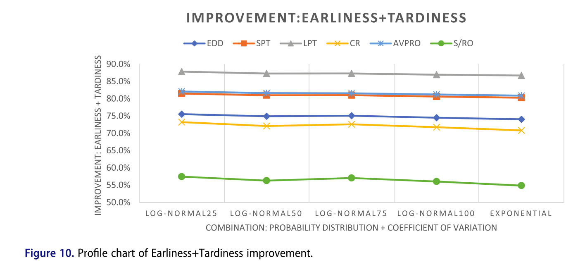
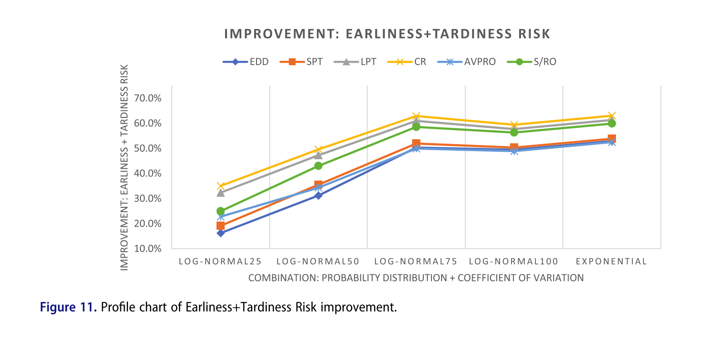
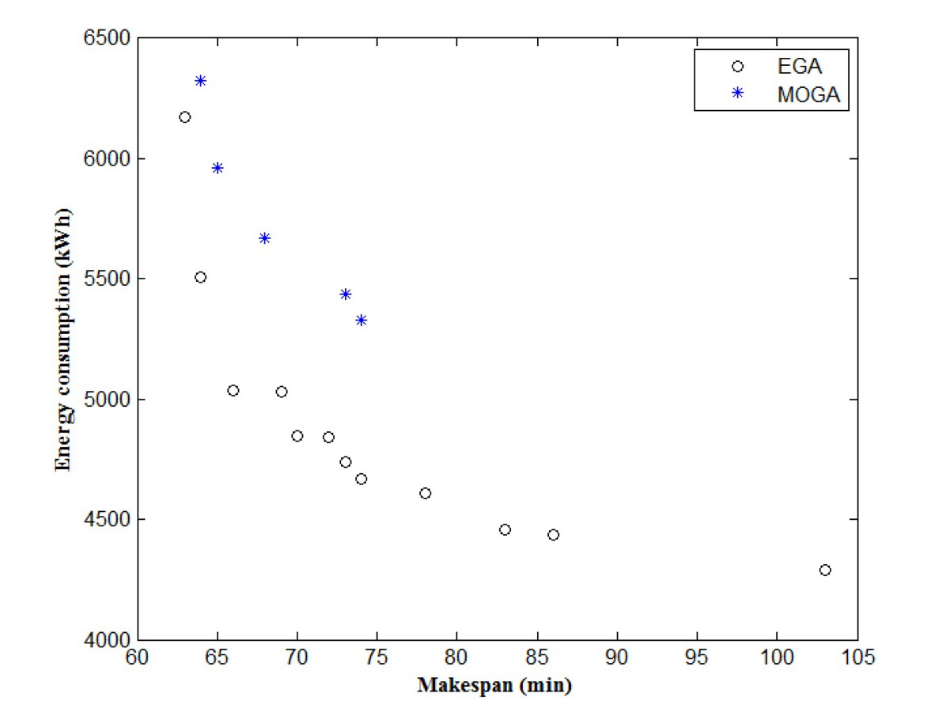
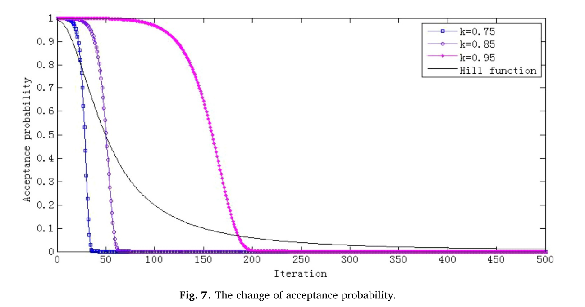
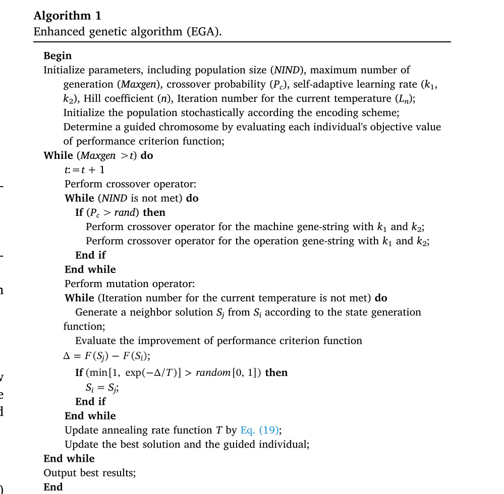
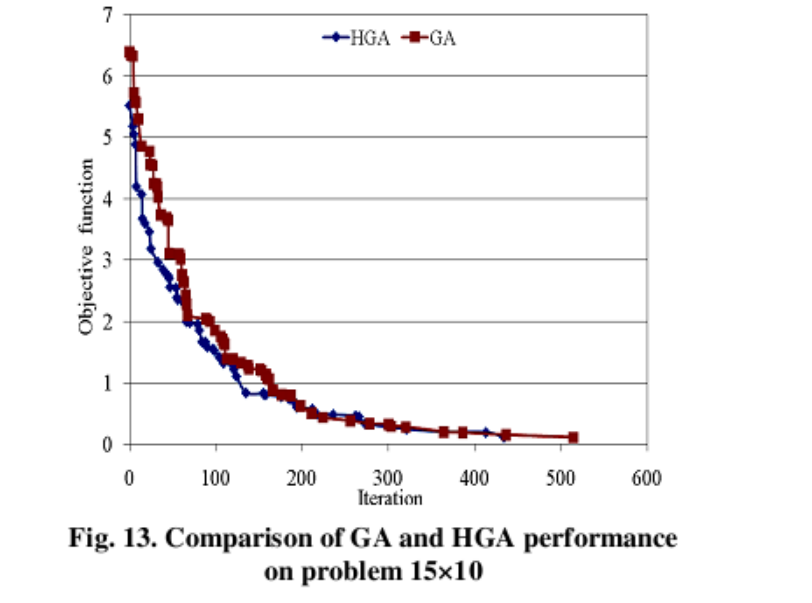
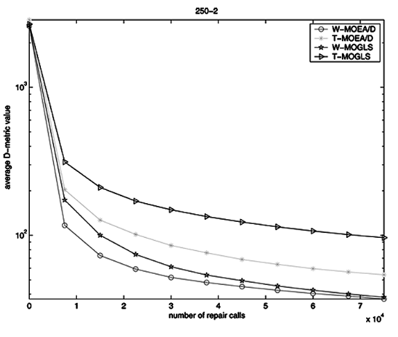
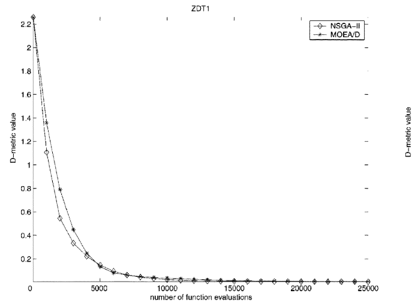

# 一种使用 NSGA-II 的仿真启发式方法求解双目标随机柔性作业车间调度问题

## 一、文章信息

- **题目**：A simheuristic approach using the NSGA-II to solve a bi-objective stochastic flexible job shop problem（一种使用 NSGA-II 的仿真启发式方法求解双目标随机柔性作业车间调度问题）
- **作者**：Camilo Andrés Rodríguez-Espinosa、Eliana María González-Neira、Gabriel Mauricio Zambrano-Rey
- **单位**：哥伦比亚波哥大 哈维里亚纳天主教大学 工学院 工业工程系（Departamento de Ingeniería Industrial, Facultad de Ingeniería, Pontificia Universidad Javeriana, Bogotá, Colombia）
- **期刊**：*Journal of Simulation*（《仿真期刊》），2024 年第 18 卷第 4 期，646–670 页；在线发表于 2023 年 7 月 5 日；DOI: 10.1080/17477778.2023.2231877（Taylor & Francis 出版，© 2023 The Operational Research Society）

## 二、背景、目的、结论

### 2.1 背景

柔性作业车间调度（FJSS）是作业车间调度（JSS）的推广——每道工序可在多台机器中选择加工，属于 NP-hard 组合优化问题，广泛应用于化工、航空、半导体、炼钢等行业。由于不完全加工时间存储成本、迟交罚款等原因，遵循准时制生产（JIT）理念，以最小化"提前/拖期之和（Earliness + Tardiness）"为核心目标。为使模型更贴近现实，文中考虑加工时间不确定（随机）这一随机因素，并采用预测式（predicive）调度思路，引入稳健性度量 "Earliness+Tardiness Risk"，以保证预测性的排产在随机扰动下仍保持较好性能。

### 2.2 目的

针对加工时间随机的双目标柔性作业车间调度问题，同时优化两个相互冲突的目标：
1. 最小化确定性环境下的提前/拖期之和（Earliness + Tardiness）；
2. 最小化"提前/拖期风险"（Earliness+Tardiness Risk），以在不确定环境下获得稳健解。

为此，提出一种**仿真启发式算法（simheuristic）**：将**非支配排序遗传算法（NSGA-II）**与**蒙特卡洛（Monte Carlo）**仿真相结合，以求得两个目标函数的帕累托（Pareto）前沿。

### 2.3 结论

所提仿真启发式算法有效求解了该双目标随机柔性作业车间调度问题，主要结论包括：

- **对比混合整数线性规划（MILP）模型**：仿真启发式在计算成本上优于对 MILP 解进行仿真的方法，能以更短时间获得更优（虽未必最优）的结果。
- **对比分派规则（EDD、SPT、LPT、CR、AVPRO、S/RO）**：仿真启发式平均将 Earliness+Tardiness 至少提升约 **55%**，将 Earliness+Tardiness Risk 至少提升约 **15%**。
- **对比确定性单目标遗传算法**：仿真启发式将 Earliness+Tardiness Risk 至少改进约 **69%**。
- **变异系数与概率分布的影响**：变异系数对两个目标函数及多数性能指标具有显著影响；在 100% 变异系数下，指数分布与对数正态分布之间存在显著差异（指数分布在除 diversity 外的指标上表现更好）。

作者强调：结果体现了将随机性纳入决策过程以及进行准确的分布拟合的重要性。未来研究方向包括采集真实 FJSS 数据进行分布拟合、加入更多随机因素（机器故障、返工、可用时间变化等）、测试其他概率分布（Gamma、Weibull）、以及与其他元启发式（禁忌搜索、PSO、迭代局部搜索等）或其他仿真范式（离散事件、agent-based）混合验证。

## 三、结果





## 四、实验方法

### 4.1 染色体设计（4.1 节）

#### 4.1.1 设计思想

基于 L. Sun et al. (2019) 的实数编码方式，将 **机器选择** 和 **工序优先级** 两个决策信息融合到一个实数中。染色体表示为一个 **二维矩阵**：

- **行**：作业（Job），记为 J1, J2, ..., Jn
- **列**：工序编号（Operation），记为 O1, O2, ..., Om

矩阵中的每个元素为一个 **实数**，其结构为：

    整数部分 k + 小数部分 f，其中 f ∈ [0, 1)

- 整数部分 k：机器索引
- 小数部分 f：工序优先级

#### 4.1.2 整数部分：机器选择

- **含义**：整数部分 k 表示该工序在其 **可加工机器集合 Mij** 中的索引（从 0 开始计数）。
- **取值范围**：0 ≤ k ≤ |Mij| - 1
- **解码规则**：
  - k = 0 → 选择 Mij 中第 1 台机器
  - k = 1 → 选择 Mij 中第 2 台机器
  - ……
  - k = |Mij| - 1 → 选择 Mij 中最后一台机器

**关键性质**：

- 不同工序的 Mij 大小 **不一定相同**，因此整数部分的取值范围因工序而异。
- 同样的整数值在不同工序中可能对应不同的机器。
- 该设计天然保证机器分配的可行性。

#### 4.1.3 小数部分：工序优先级

- **含义**：小数部分 f ∈ [0, 1) 表示该工序在同级可调度工序中的 **相对优先级**。
- **解码规则**：
  - 在解码的每一步，对于所有当前可调度的工序（其前序工序已完成），比较它们的小数部分。
  - **小数部分越大，优先级越高**，越先被安排加工。

**关键性质**：

- 优先级是动态的，随调度进展不断变化。
- 小数部分只影响同一作业内已解锁工序之间的竞争，不会破坏工序顺序约束。

#### 4.1.4 染色体示例（论文图3）

|      | O1   | O2   | O3   |
| ---- | ---- | ---- | ---- |
| J1   | 2.88 | 0.19 | 1.83 |
| J2   | 0.28 | 0.22 | 1.43 |
| J3   | 0.80 | 2.44 | —    |

以 O11 = 2.88 为例：

- 整数部分 2：M11 = {M1, M2, M3}，索引 2 → 选择 M3
- 小数部分 0.88：优先级为 0.88

#### 4.1.5 设计优点

| 优点         | 说明                                               |
| ------------ | -------------------------------------------------- |
| 紧凑性       | 每个工序只需一个实数，**减少染色体长度和变量数量** |
| 可行性保证   | 整数部分范围限定在                                 |
| 灵活性       | 小数部分优先级可动态调整                           |
| 易于遗传操作 | 交叉、变异操作简单，且解码过程时间复杂度低         |
| 统一编码     | **机器分配和工序排序两个子问题统一在一个染色体中** |

### 4.2 初始种群生成（4.2 节）

#### 4.2.1 总体策略

初始种群采用 **混合策略** 生成：

> **一部分个体用 6 种调度规则生成；剩余个体完全随机生成。**

- 6 种调度规则 = 3 种静态规则 + 3 种动态规则
- 目的：兼顾 **初始解质量** 与 **种群多样性**，加速 NSGA-II 收敛。

#### 4.2.2 生成解的核心逻辑（逐步调度）

生成一个完整调度的过程是 **逐步调度**，每一步做两件事：

**第一步：为每个作业选择候选机器**

对每个作业当前待加工工序 (i, j)：

1. 计算每台可加工机器 m ∈ Mij 的 **可用时间**。
2. 选择 **可用时间最小** 的机器。
3. 若并列，选择 **加工时间 PTijm 最小** 的机器。
4. 若仍并列，**随机选一台**。

**第二步：从所有作业中选一个来加工**

1. 计算每个作业的 **最早可用时间**（= max(上一道工序完工时间, 候选机器可用时间)）。
2. 选择 **最早可用时间最小** 的作业。
3. 若并列，用 6 种调度规则之一打破平局。
4. 若仍并列，**随机选一个**。

#### 4.2.3 六种调度规则

**静态规则（不随调度过程变化）**

| 规则 | 全称                     | 选择依据   | 含义             |
| ---- | ------------------------ | ---------- | ---------------- |
| EDD  | Earliest Due Date        | 最小 EWi   | 交货期最紧的优先 |
| SPT  | Shortest Processing Time | 最小 PTijm | 加工最快的优先   |
| LPT  | Longest Processing Time  | 最大 PTijm | 加工最慢的优先   |

**动态规则（依赖当前调度状态）**

**CR（Critical Ratio，临界比）**，式(23)：

    CRi = max( (SWi - STij) / Σ_{h=1}^{j} PTihm_bar , 0 )

- 选 CRi 最小的作业。
- CRi < 1 表示时间紧迫，需优先加工。

**AVPRO（Average Processing Time per Operation）**，式(24)：

    APi = ( Σ_{h=j}^{|Ii|} PTihm_bar ) / ( |Ii| - j + 1 )

- 选 APi 最小的作业。
- 剩余工序平均加工时间越短越优先。

**S/RO（Slack per Remaining Operations）**，式(25)：

    SRi = max( SWi - CTi(j-1) , 0 ) / ( |Ii| - j + 1 )

- 选 SRi 最小的作业。
- 每道剩余工序平均松弛时间越小越紧急。

#### 4.2.4 生成解的完整流程

    1. 初始化：所有作业当前工序 j=1，所有机器可用时间=0。
    
    2. 重复直到所有工序调度完毕：
       a. 对每个未完成作业 i：
          - 选候选机器（最早可用 → 加工时间最小 → 随机破平局）
          - 计算最早可用时间
       b. 从所有作业中选最早可用时间最小者
          - 并列 → 调度规则破平局 → 随机
       c. 安排该工序：
          - 开始时间 = max(作业上一道工序完工, 机器可用时间)
          - 完工时间 = 开始时间 + 加工时间
          - 更新机器可用时间和作业当前工序
    
    3. 所有工序调度完毕，得到一个初始解。

#### 4.2.5 反向编码成染色体

调度方案生成后，需反向编码：

- **整数部分**：记录每道工序选的机器在 Mij 中的索引。
- **小数部分**：按调度顺序归一化到 [0, 1)，越早调度小数部分越大。

**示例**：若总工序数为 8，调度顺序为第 r 个，则小数部分可取 (8 - r) / 8。

#### 4.2.6 初始种群组成（示意）

设种群规模 N = 1000：

| 来源     | 数量（示意） |
| -------- | ------------ |
| EDD      | ~100         |
| SPT      | ~100         |
| LPT      | ~100         |
| CR       | ~100         |
| AVPRO    | ~100         |
| S/RO     | ~100         |
| 随机生成 | ~400         |

> 论文未明确给出每种规则的具体数量，以上为示意。

#### 4.2.7 设计优点

- **质量**：调度规则体现领域知识，生成较优初始解。
- **多样性**：**6 种规则从不同角度生成解，随机解补充探索空间。**
- **加速收敛**：好的起点使 NSGA-II 更快逼近 Pareto 前沿。
- **避免偏差**：随机解防止种群过早收敛到局部最优。

### 4.3 交叉操作（4.4 节）

#### 4.3.1 交叉方式

采用 **基于位置的概率交叉**（均匀交叉的变体）：

1. 对染色体的 **每个位置** 生成一个 [0, 1] 的随机数。
2. 若随机数 < 交叉概率 Pc，子代取 **父代1** 的基因。
3. 否则，子代取 **父代2** 的基因。

#### 4.3.2 示例（论文图5）

- 黄色：父代染色体
- 红色：子代染色体
- 每个基因独立选择来自父代1还是父代2

#### 4.3.3 交叉后的甘特图（论文图6）

交叉生成的子代解码后得到新调度，论文示例中 ET = 1。

#### 4.3.4 与拥挤度距离的关系

- 在非支配排序后，每个 Pareto 前沿内的染色体按 **拥挤度距离** 排序。
- **拥挤度距离越大**，表示该解周围越稀疏，越应保留以维持多样性。
- 前沿两端的解拥挤度距离设为 ∞。
- 选择交叉父代时，优先选择拥挤度大的解，促进 **探索**。

#### 4.3.5 选择与更新流程

1. 从当前种群中随机选一对染色体进行交叉，生成 Q 个子代。
2. 得到规模为 N + Q 的混合种群。
3. 对混合种群进行 **快速非支配排序** 和 **拥挤度距离** 计算。
4. 保留前 N 个染色体作为下一代种群。
5. 重复直到满足停止准则。

#### 4.3.6 参数设置

| 参数        | 值   |
| ----------- | ---- |
| 种群规模 N  | 1000 |
| 子代数量 Q  | 500  |
| 交叉概率 Pc | 30%  |
| 迭代代数    | 750  |

### 4.4 变异操作（4.5 节）

#### 4.4.1 变异方式

1. 对每个染色体生成一个 [0, 1] 的随机数。
2. 若随机数 < 变异概率 Pm，则对该染色体执行变异。
3. **变异操作**：选择染色体中的 **某一个作业**，**反转其小数部分的顺序**。

#### 4.4.2 示例（论文图7）

**变异前**：

|      | O1   | O2   | O3   |
| ---- | ---- | ---- | ---- |
| J1   | 2.88 | 0.19 | 2.47 |
| J2   | 1.38 | 0.22 | 1.43 |
| J3   | 0.33 | 2.44 | —    |

选择 J3 进行变异，反转其小数部分顺序：

**变异后**：

|      | O1   | O2   | O3   |
| ---- | ---- | ---- | ---- |
| J1   | 2.88 | 0.19 | 2.47 |
| J2   | 1.38 | 0.22 | 1.43 |
| J3   | 0.44 | 2.33 | —    |

- J3, O1：0.33 → 0.44
- J3, O2：2.44 → 2.33

注意：**整数部分不变**（机器选择不变），只改变 **小数部分**（优先级）。

#### 4.4.3 变异后的甘特图（论文图8）

变异后的子代解码得到新调度，论文示例中 ET = 3。

#### 4.4.4 变异的意义

- **保持机器选择多样性**：整数部分不变，机器分配方案不变。
- **改变工序优先级**：通过反转小数部分，改变同一作业内工序的调度顺序。
- **局部搜索**：变异是对解的小扰动，有助于跳出局部最优。
- **参数设置**：变异概率 Pm = 2.5%（论文表4）。

### 4.5 设计要点回顾

1. **编码紧凑**：一个实数同时编码机器和优先级，减少变量数量。
2. **可行性保证**：整数部分范围限定在 |Mij| 内，解码天然可行。
3. **动态优先级**：小数部分在解码过程中动态比较，适应性强。
4. **混合初始化**：调度规则保证质量，随机解保证多样性。
5. **均匀交叉**：每个基因独立选择父代，保持种群多样性。
6. **局部变异**：反转作业内小数部分，微调优先级而不改变机器选择。
7. **精英保留**：通过非支配排序 + 拥挤度距离，保留优质解并维持多样性。

## 五、自我想法

* 从各个角度生成初始解能够丰富种群多样性


# 带运输约束的节能型柔性作业车间调度问题的多目标优化

## 一、文章信息

- **题目**：Multi-objective optimization for energy-efficient flexible job shop scheduling problem with transportation constraints（带运输约束的节能型柔性作业车间调度问题的多目标优化）
- **作者**：Dai Min（戴敏，通讯作者）、Tang Dunbing（唐敦兵）、Giret Adriana、Salido Miguel A.
- **单位**：
  - Dai Min：扬州大学机械工程学院（College of Mechanical Engineering, Yangzhou University），江苏扬州
  - Tang Dunbing：南京航空航天大学机电学院（College of Mechanical and Electrical Engineering, Nanjing University of Aeronautics and Astronautics），南京
  - Giret Adriana、Salido Miguel A.：西班牙瓦伦西亚理工大学 信息系统与计算系/AI2（Departamento de Sistemas Informáticos y Computación/AI2, Universitat Politècnica de València），瓦伦西亚
- **期刊**：*Robotics and Computer-Integrated Manufacturing*（《机器人与计算机集成制造》），2019 年第 59 卷，143–157 页；DOI: 10.1016/j.rcim.2019.04.006（Elsevier，© 2019 Elsevier Ltd.）

## 二、背景、目的、结论

### 2.1 背景

制造业面临因能源消耗及其环境影响所带来的巨大经济和环保压力。据国际能源展望，2012 年工业部门消耗了全球约 54% 的能源，且能耗逐年增长；中国制造业消耗了全国一半以上的电力并产生大量 CO₂ 排放。相比在机器层、产品层进行节能改造（投资大），从生产管理层采用**智能调度/节能调度**是中小型企业更可行的节能策略。然而，以往节能调度研究大多只关注加工环节的能耗，而**忽略了 AGV 等运输资源在工作间转运件所产生的运输能耗**。实际生产中加工与运输存在强烈耦合：工序的机器选择会影响 AGV 的运输时间，运输时间又会导致机器等待，运输环节本身也会产生可观能耗。因此，**本文在柔性作业车间调度中引入运输约束，同时优化加工与运输，研究总能耗最小化问题。**

### 2.2 目的

针对**带运输约束的节能型柔性作业车间调度问题（EFJSP）**，建立将**总能耗与制造周期（makespan）同时最小化**的多目标优化模型，并开发一种**增强型遗传算法（Enhanced Genetic Algorithm, EGA）** 求解该 NP-hard 问题，以获得能耗与工期之间的帕累托最优解。

### 2.3 结论

1. **模型与算法有效**：提出的节能型柔性作业车间调度模型与增强遗传算法（EGA）能有效、高效地求解该问题；EGA 在 HV（超体积）和 IGD（反向世代距离）两个综合指标上均优于普通多目标遗传算法（MOGA），在小、中、大（20×20、50×50、80×50）规模算例上都能获得收敛性和分布性更好、数量更多、质量更高的帕累托解。
2. **目标之间存在冲突**：makespan 与总能耗呈相互制约的冲突关系，需在两者之间权衡。
3. **运输能耗不可忽视**：运输能耗对总能耗有不可忽略的影响。运输时间越长，makespan 和总能耗越高，运输环节能耗占比越大；当运输时间高于加工时间时，还会直接影响机器的选择和各工序的加工顺序，因此合理的车间布局和缩短运输时间是一种有效的节能调度策略。
4. **未来工作**：进一步提升模型精度与计算效率；考虑机器故障、急单、撤单等实际动态事件；并研究动态调度环境下的节能问题。

## 三、结果



## 四、实验方法

### 4.1 染色体编码

每条染色体由两层基因串组成，总长度为：

$$
L = 2 \times \sum_{i=1}^{n} N_i
$$

其中 $N_i$ 为工件 $J_i$ 的工序数。

| 层次   | 名称                                | 含义                                                         |
| ------ | ----------------------------------- | ------------------------------------------------------------ |
| 第一层 | 机器基因串（machine gene-string）   | 每个基因表示对应工序在其可选机器集合中的索引                 |
| 第二层 | 工序基因串（operation gene-string） | 基于工序的编码，同一工件编号第 $p$ 次出现表示该工件第 $p$ 道工序 |

**示例**（3 工件、5 机器、共 8 道工序，$L = 16$）：

- 机器基因串 C1：`2 3 5 3 4 1 4 3`
- 工序基因串 C2：`1 3 2 1 3 3 2 1`

### 4.2 交叉操作

EGA 的交叉算子借鉴了 **PSO 的信息共享机制**：先根据非支配排序和拥挤距离选出**引导个体（guided individual）**，再让父代向引导个体和另一父代学习。引入两个**自适应学习因子** $k_1$、$k_2$：

- $k_1$：向引导个体学习的比例；
- $k_2$：向另一父代学习的比例。

交叉操作分两层分别进行。

#### 4.2.1 机器基因串的交叉

**符号说明**

| 符号     | 含义                   |
| -------- | ---------------------- |
| G1       | 机器基因串层的引导个体 |
| P11、P21 | 两个父代个体           |
| O11      | 最终子代               |
| O11′     | 含空位“0”的中间个体    |
| L        | 机器基因串长度         |

**步骤**

**Step 1**：确定引导个体 G1 和父代 P11、P21。

**Step 2**：生成位置集合 A 和 B

- 从 G1 中随机选择 $L/2 \times k_1$ 个位置，构成集合 A；
- 从 P21 中随机选择 $L/2 \times k_2$ 个位置（**排除集合 A 中的位置**），构成集合 B。

**Step 3**：生成中间个体 O11′

- 将 G1 中集合 A 对应位置的基因，按顺序复制到 O11′ 的对应位置；
- 将 P21 中集合 B 对应位置的基因，按顺序复制到 O11′ 的对应位置；
- 其余位置置为“0”，表示空位。

**Step 4**：填充空位，得到最终子代 O11

- 从左到右检查 O11′ 中的空位；
- 依次用父代 P11 中对应位置的基因填充这些空位；
- 得到完整的子代 O11。

**核心思想**：**子代 = 一部分来自引导个体 G1 + 一部分来自另一父代 P21 + 剩余部分来自自身父代 P11。**

#### 4.2.2 工序基因串的交叉

**符号说明**

| 符号       | 含义                                    |
| ---------- | --------------------------------------- |
| G2         | 工序基因串层的引导个体                  |
| P12、P22   | 两个父代个体                            |
| P12′、P22′ | 父代中集合 C 对应位置置“0”后的个体      |
| P12″       | 父代 P12 中集合 D 对应位置置“0”后的个体 |
| O12′、O12″ | 中间个体                                |
| O12        | 最终子代                                |

**步骤**

**Step 1**：确定引导个体 G2 和父代 P12、P22。

**Step 2**：从 G2 和 P22 生成中间个体 O12′

- 随机选择 $L/2 \times k_1$ 个位置，构成集合 C；
- 将 G2 中集合 C 对应位置的基因复制到 O12′ 的对应位置；
- 将 P12、P22 中集合 C 对应位置的基因置为“0”，得到 P12′、P22′；

**Step 3**：从 P22′ 和 P12′  生成中间个体 O12″

- 在 **P22′ 的非空位置**中，随机选择 $L/2 \times k_2$ 个位置，构成集合 D；
- 将 P22′ 中集合 D 对应位置的基因，**复制到 O12″ 的相同位置**；
- 将 P12′  中集合 D 对应位置置为“0”，得到 P12″。

**Step 4**：填充空位，得到最终子代 O12

- 将 P12″ 中剩余的非空基因，按顺序依次填入 O12″ 的空位；
- 得到完整的子代 O12。

**注意事项**：

- 集合 D 是在 **P22′ 的非空位置**中选的，不是在空位中选；
- 复制到 O12″ 时是**复制到与集合 D 相同的位置**，不是随机空位；
- 从 P12 填充基因时，是**按从左到右顺序填入第一个空位**，不是随机选空位；
- **论文图 5 中 O12″ 的标绿基因位置（第 6、8 位）与正文 Step 3 描述不一致，应以正文算法描述为准。**

### 4.3 变异操作

EGA 用**改进的模拟退火算法（SAA）**替代传统 GA 的变异算子，以增强局部搜索能力、避免早熟收敛。变异操作包含三个模块：

#### 4.3.1 状态生成函数

用于从当前个体生成一个新个体（邻域解）。

**机器基因串**：

- Step 1：随机选择若干个位置；
- Step 2：将这些位置的基因值改为对应工序可选机器集合中的其他机器编号。

**工序基因串**：

- Step 1：随机选择两个位置；
- Step 2：交换这两个位置的基因元素。

#### 4.3.2 接受概率模块

基于 Boltzmann 函数定义劣解的接受概率：

$$
p(i \rightarrow j) =
\begin{cases}
1, & F(i) \geq F(j) \\
\exp\left(\dfrac{F(i) - F(j)}{T}\right), & F(i) < F(j)
\end{cases}
$$

其中：

- $F(i)$：新状态的目标函数值；
- $F(j)$：当前状态的目标函数值；
- $T$：当前温度。

#### 4.3.3 退火速率模块

**传统退火速率函数**：
$$
T(t) = k \times T(t-1)
$$

其中 $k \in (0,1)$，通常取 0.75–0.95。

**EGA 提出的新退火速率函数（基于 Hill 函数）**：

$$
T(t) = k \times \frac{T_0^n}{T_0^n + t^n}
$$

其中：

- $T_0$：温度阈值，与初始温度相关；
- $n$：Hill 系数；
- $t$：迭代次数。

**优势**：新退火速率函数具有更高的劣解接受概率，能有效跳出局部最优，避免早熟收敛。



可以看出改进后的退火速率函数更平滑。

### 4.4 EGA 整体流程

见论文算法1



## 五、自我想法

* 对于传统的EA算法，可以融合其他类似的算法，如PSO、蚁群、灰狼等
* 融合模拟退火，以一定概率接收较差的解


# 基于帕累托的求解柔性作业车间调度问题的混合多目标进化算法

## 一、文章信息

- **题目**：Pareto-based Hybrid Multi-Objective Evolutionary Algorithm for Flexible Job-shop Scheduling Problem（基于帕累托的求解柔性作业车间调度问题的混合多目标进化算法）
- **作者**：
  1. M. Nagamani（第一作者），马德拉斯大学 Presidency College 研究学者（Research Scholar），金奈
  2. Dr. E. Chandrasekaran，Presidency College 数学副教授，金奈
  3. Dr. D. Saravanan，Karpaga Vinayaga 工程技术学院 数学教授，金奈
- **单位**：印度金奈（Chennai）——Presidency College（University of Madras）及 Karpaga Vinayaga College of Engineering and Technology
- **期刊**：*IOSR Journal of Mathematics (IOSR-JM)*，第 9 卷第 1 期（2013 年 11–12 月），36–45 页（e-ISSN: 2278-5728, p-ISSN: 2319-765X）

## 二、背景、目的、结论

### 2.1 背景

作业车间调度问题（JSP）是组合优化中最困难的问题之一，属 NP-hard；柔性作业车间调度问题（FJSP）是经典 JSP 的推广，允许一道工序在多台可选机器中择一加工，因此更贴近实际制造（如柔性制造系统）。FJSP 可分为两个子问题：**路径子问题**（将工序分配到机器）和**排序子问题**（在各机器上对已分配工序排序）。与单目标 FJSP 相比，多目标 FJSP 的研究仍较少，且多数传统方法只使用单一优化算法，或将多个冲突目标通过加权法合并。由于**各目标（makespan、最大机器负载、总机器负载）之间存在冲突，需要一种更合理的多目标处理方法，并借助局部搜索提高解的质量**。

### 2.2 目的

针对柔性作业车间调度问题，同时优化三个相互冲突的目标：
1. 最小化 makespan（完工时间）；
2. 最小化最大机器负载（关键机器的工作负荷）；
3. 最小化所有机器的总负载。

提出一种**混合多目标进化算法（hybrid evolutionary algorithm）**：以**进化算法进行全局搜索**，以**爬山法（hill climbing）进行局部搜索**，并采用**扰动全局准则（compromise programming / 妥协规划）方法**代替常用的加权法来引导搜索方向，从而在合理运行时间内获得大量帕累托最优解。

### 2.3 结论

1. **算法有效**：所提混合进化算法能有效求解多目标柔性作业车间调度问题，在 4×5、8×8、10×10、15×10 四个代表性算例上均取得良好结果，相较于已有文献算法表现出更优性能。
2. **混合策略优势**：进化算法负责全局搜索，爬山法负责局部搜索；先由 EA 得到初始解，再由爬山法进行邻域搜索改进。与仅用进化算法相比，混合算法能在更少的迭代次数内达到可接受的解。
3. **方法贡献**：
   - 提出求解最小化 makespan、总机器负载、最大机器负载三目标 FJSP 的混合算法；
   - 采用借鉴妥协规划（compromise programming）的方法求解多目标 FJSP，且实验表明该方法比传统加权法更合理；
   - 验证了局部搜索（爬山法）相比单纯进化算法的改进效果。
4. **局限与后续**：文中局部搜索（爬山法）的邻域仅改变各机器上的作业顺序，因此主要改进 makespan，而不影响 Max WL 和总负载 ∑WL；对未来研究和进一步扩展做了展望。

## 三、结果



## 四、实验方法

### 4.1 交叉操作

交叉操作对 **A-string 和 B-string 分别独立进行**，方法不同。

#### 4.1.1 A-string 交叉（两点交叉）

- **操作对象**：机器分配向量
- **方法**：随机选择两个位置，交换两个父代在这两个位置之间的整个子串
- **特点**：通用的两点交叉，用于探索不同的机器分配组合，**不是 POX**
- **作用**：探索机器组合

#### 4.1.2 B-string 交叉（POX 交叉）

- **操作对象**：工序排序向量
- **方法**：
  1. 将所有工件随机分成两组 J1 和 J2；
  2. 子代 1 保留父代 1 中属于 J1 的工件，保持原位置不变；
  3. 子代 2 保留父代 2 中属于 J2 的工件，保持原位置不变；
  4. 空位分别用另一父代中属于另一组的工件按原顺序依次填入。
- **特点**：本质上是 **POX（Precedence Operation Crossover）**，以工件为单位交叉，保留部分工件位置，其余按顺序填充，**自动保证子代可行性**
- **作用**：继承父代的工序顺序信息

### 4.2 变异操作

论文中**只对 B-string 进行变异**，A-string 不参与变异。

#### 4.2.1 变异步骤

1. 随机生成两个位置；
2. 将 B-string 在这两个位置之间的子串进行**反转**；
3. 得到新的 B-string。

#### 4.2.2 变异特点

- **变异概率小**（论文中取 0.1）；
- 防止算法陷入局部最优；
- 维持种群多样性；
- 只改变工序顺序，不改变机器分配；
- 操作简单，计算量小。

### 4.3 爬山操作

爬山法嵌入在 EA 之后，对每个染色体进行局部精修。

#### 4.3.1 邻域定义

> **改变每台机器上已分配工件的加工顺序**

即：

- **不改变 A-string**（机器分配不变）；
- **只改变 B-string**（工序排序）；
- 通过交换、插入、反转等操作生成邻居。

#### 4.3.2 搜索策略

采用**最陡上升爬山法（Steepest Ascent Hill Climbing）**：

1. 生成当前解的所有邻居；
2. 比较所有邻居的 makespan；
3. 选择 makespan 最小的邻居；
4. 如果比当前解更好，就移动过去，重复；
5. 如果邻域中没有更好的解，就停止。

#### 4.3.3 优化目标

- **只能改善 makespan（Cmax）**；
- **不能改变 Max WL 和 ΣWL**（因为机器分配不变）。

### 4.4 三者在整体流程中的位置

```
Step 1. 随机生成初始种群（A-string + B-string）
                ↓
Step 2. 计算 Cmax、Max WL、ΣWL，用全局准则法评估适应度
                ↓
Step 3. 交叉 + 变异，生成新种群
        - A-string：两点交叉
        - B-string：POX 交叉
        - B-string：反转变异
                ↓
Step 4. 对每个染色体执行爬山法局部搜索
        - 邻域：只改变工序顺序
        - 策略：最陡上升
        - 目标：仅优化 makespan
                ↓
Step 5. 提取最佳适应度
                ↓
Step 6. 判断终止条件，未满足则继续迭代
                ↓
Step 7. 输出最优解
```

### 4.5 关键要点总结

| 项目           | 内容                                       |
| -------------- | ------------------------------------------ |
| 编码方式       | A-string（机器分配）+ B-string（工序排序） |
| A-string 交叉  | 两点交叉                                   |
| B-string 交叉  | POX 交叉                                   |
| 变异           | 只对 B-string 反转变异                     |
| 变异概率       | 0.1                                        |
| 爬山法邻域     | 改变工序顺序，不改变机器分配               |
| 爬山法策略     | 最陡上升（枚举所有邻居，选最优）           |
| 爬山法优化目标 | 仅 makespan                                |
| 交叉作用       | 探索新解（机器组合 + 工序顺序）            |
| 变异作用       | 维持多样性，防止局部最优                   |
| 爬山作用       | 局部精修，加速收敛                         |

## 五、自我想法

* 多目标融合成单目标优化
* 对于遗传算法生成的解，探索其邻域的解是否存在更好的，加强局部搜索


# MOEA/D：一种基于分解的多目标进化算法

## 一、文章信息

- **题目**：MOEA/D: A Multiobjective Evolutionary Algorithm Based on Decomposition（MOEA/D：一种基于分解的多目标进化算法）
- **作者**：Qingfu Zhang（张清福，IEEE 高级会员）和 Hui Li（李辉）
- **单位**：英国埃塞克斯大学 计算机科学系（Department of Computer Science, University of Essex, Wivenhoe Park, Colchester, UK）
- **期刊**：*IEEE Transactions on Evolutionary Computation*，第 11 卷第 6 期，2007 年 12 月，712–731 页；DOI: 10.1109/TEVC.2007.892759

## 二、背景、目的、结论

### 2.1 背景

**多目标优化问题（MOP）的各目标常相互冲突，需在目标间权衡，并以帕累托最优定义最佳折中**。决策者需要的是沿帕累托前沿（PF）均匀分布、数量适中、具有代表性的帕累托解集。传统多目标优化的基本策略是"分解"（**将多目标问题分解为若干标量子问题**），但这一思想当时在进化多目标优化中尚未被广泛采用。当时主流的 MOEA（如 NSGA-II、SPEA-II、MOGLS 等）都把 MOP 当作一个整体处理，采用基于支配关系的适应度赋值和拥挤距离等多样性维护机制，而这些机制正是非分解类 MOEA 的难点所在。

### 2.2 目的

提出一种**基于分解的多目标进化算法（MOEA/D）**：将多目标问题显式地分解为多个标量优化子问题，并**同时**优化它们；每个子问题仅利用其若干**邻近子问题**的信息进行求解，从而降低每代的计算复杂度。同时研究三种分解方法（**加权和法、切比雪夫法、边界交集法/PBI**），并将其与 MOGLS、NSGA-II 进行对比，验证该框架的可行性、效率、可扩展性及对邻域大小的敏感性。

### 2.3 结论

1. **有效性与低复杂度**：MOEA/D 将数学规划中的分解思想自然引入进化算法，每代计算复杂度低于 MOGLS 和 NSGA-II；在多目标 0–1 背包问题和连续多目标测试问题上，使用简单分解方法的 MOEA/D 优于或等同于 MOGLS 和 NSGA-II。
2. **均匀分布能力**：采用 PBI（基于惩罚的边界交集）高级分解方法的 MOEA/D，可在三目标连续测试实例上生成**非常均匀分布**的帕累托解集。
3. **处理尺度差异目标**：通过目标归一化技术，MOEA/D 能很好地处理量纲/尺度差异悬殊的目标。
4. **小种群与低代价**：MOEA/D 用小种群即可在低计算成本下获得少数且均匀分布的帕累托解。
5. **可扩展性与鲁棒性**：计算成本随决策变量数量线性增长；算法对邻域大小 的设置不敏感。
6. **方法论意义**：该框架为将数学规划领域长期研究的分解策略引入进化多目标优化提供了自然途径，新的分解方法和标量优化技术都可便捷地集成到 MOEA/D 框架中。

## 三、结果



## 四、实验方法

### 4.1 核心思想

MOEA/D 把多目标问题**分解成 $N$ 个标量子问题**，每个子问题配一个预设的权重向量 $\lambda^i$。种群中的第 $i$ 个解 $x^i$ 就是"第 $i$ 个子问题当前找到的最优解"。算法**一次性同时**优化所有子问题，而每个子问题只借用它"邻近子问题"的信息来优化自己。

> 两个不依赖问题先验知识的关键机制：
> 1. **邻域 $B(i)$ 由权重向量的几何距离决定**，与最优解无关，事前纯构造。
> 2. **Step 2.2 的改进靠计算已知的标量函数 $g^{te}$ 做局部搜索**，不需要知道全局最优。

### 4.2 每代维护的数据结构

| 符号                       | 含义                                      |
| -------------------------- | ----------------------------------------- |
| 种群 $x^1,\dots,x^N$       | $x^i$ 是第 $i$ 个子问题的当前解           |
| $FV^1,\dots,FV^N$          | $FV^i=F(x^i)$，各解的目标向量             |
| 参考点 $z=(z_1,\dots,z_m)$ | 各目标"至今最优值"（最小化时 $z_j=\min$） |
| 外部种群 $EP$              | 存储搜索中发现的非支配解（最终输出）      |

### 4.3 算法流程

**输入**：MOP、停止准则、$N$、均匀权向量 $\lambda^1,\dots,\lambda^N$、邻域大小 $T$。**输出**：$EP$。

**Step 1 初始化**
- 1.1 $EP=\emptyset$。
- 1.2 计算任意两个**权重向量**的欧氏距离，为每个 $\lambda^i$ 找最近的 $T$ 个，得到邻域 $B(i)$。
- 1.3 **随机或按问题特定方法**生成初始种群 $x^1,\dots,x^N$（不需要是好解）。
- 1.4 按问题特定方法初始化参考点 $z$。

**Step 2 更新**（对 $i=1,\dots,N$ 依次执行）
- 2.1 **繁殖**：从 $B(i)$ 随机选两个下标 $k,l$，用遗传算子（交叉+变异）基于 $x^k,x^l$ 生成新解 $y$。
- 2.2 **改进**：对新解 $y$ 施加问题特定的修复/改进启发式 $\to y'$（实践中就是"在 $y$ 附近试探，降低标量函数 $g^{te}$"，见下文例子）。
- 2.3 **更新参考点**：若 $f_j(y')<z_j$（最小化），则更新 $z_j$。
- 2.4 **更新邻域解**：对每个 $j\in B(i)$，若 $g(y'|\lambda^j,z)\le g(x^j|\lambda^j,z)$，则用 $y'$ 替换 $x^j$。
- 2.5 **更新 $EP$**：删除被 $F(y')$ 支配的点；若 $F(y')$ 不被支配则加入。

**Step 3** 满足停止准则则终止输出 $EP$，否则回到 Step 2。

### 4.3 三个要点

1. **为何只用有限个子问题**：决策者只需有限个均匀分布的解，优化全部聚合函数是浪费计算。
2. **多样性从哪来**：子问题（权重）之间的差异自然转化为种群多样性，无需拥挤距离之类的额外机制。
3. **邻域 $T$ 的作用（交配限制）**：$T$ 太小→后代与父代太像，缺探索；$T$ 太大→父代对当前子问题是劣解，缺开发，还增加计算开销。

### 4.4 完整例子

#### 4.4.1 问题

最小化 $f_1(x)=x,\ f_2(x)=1-x,\ x\in[0,1]$。帕累托前沿为直线 $f_1+f_2=1$。

#### 4.4.2 分解：权重与邻域（纯几何构造）

取 $N=6$ 个均匀权重：

$\lambda^1=(0,1),\ \lambda^2=(0.2,0.8),\ \lambda^3=(0.4,0.6),\ \lambda^4=(0.6,0.4),\ \lambda^5=(0.8,0.2),\ \lambda^6=(1,0)$

在**权空间**里按欧氏距离找 $T=3$ 个最近邻（只算权向量距离，不碰解）：

$$B(1)=\{1,2,3\},\ B(2)=\{1,2,3\},\ B(3)=\{2,3,4\},\ B(4)=\{3,4,5\},\ B(5)=\{4,5,6\},\ B(6)=\{4,5,6\}$$

> 注意：这里完全没有用到"最优解"。

#### 4.4.3 初始化（随机，不是最优）

随机起点：$[x^1,\dots,x^6]=[0.6,\ 0.4,\ 0.7,\ 0.3,\ 0.9,\ 0.1]$

$FV\Rightarrow (0.6,0.4),\ (0.4,0.6),\ (0.7,0.3),\ (0.3,0.7),\ (0.9,0.1),\ (0.1,0.9)$

参考点 $z=(0.1,0.1)$（$f_1$ 与 $f_2$ 各自当前最小值），$EP=\emptyset$。

#### 4.4.4 一次更新（$i=3$，$\lambda^3=(0.4,0.6)$，$B(3)=\{2,3,4\}$）

**1 繁殖**：从 $\{2,3,4\}$ 随机挑 $k=2$（$x^2=0.4$）、$l=4$（$x^4=0.3$），交叉+变异 → $y=0.55$。

**2 改进（诚实的局部搜索，不算答案）**：只算 $g^{te}(x|\lambda^3,z)=\max(0.4|x-0.1|,\ 0.6|0.9-x|)$，小步试探：

- $y=0.55$：$g=\max(0.18,0.21)=0.21$
- 试 $0.58$：$g=\max(0.192,0.192)=0.192 < 0.21$，接受
- 试 $0.60$：$g=0.20>0.192$，基本到顶，停下

$\Rightarrow y'=0.6,\ F(y')=(0.6,0.4)$

> 是贪心搜索自己"爬"到 0.6 附近，不是提前知道答案。

**3 更新 $z$**：$f_1(y')=0.6,\ f_2(y')=0.4$ 都不小于 $0.1$，$z$ 不变。

**4 更新邻域**（逐个邻居比较 $g^{te}$）：

- $j=2$：$g(y')=0.24<g(x^2)=0.4$ ⇒ **替换** $x^2:0.4\to0.6$
- $j=3$：$g(y')=0.2<g(x^3)=0.24$ ⇒ **替换** $x^3:0.7\to0.6$
- $j=4$：$g(y')=0.3>g(x^4)=0.24$ ⇒ **不替换**

**5 更新 $EP$**：$(0.6,0.4)$ 不被支配，加入 $EP$。

#### 4.4.5 收敛结果

多轮后种群趋于各子问题最优：$x\approx\{1,\ 0.8,\ 0.6,\ 0.4,\ 0.2,\ 0\}$，$EP$ 均匀铺满前沿：

$$(1,0),\ (0.8,0.2),\ (0.6,0.4),\ (0.4,0.6),\ (0.2,0.8),\ (0,1)$$

### 一句话记忆

**MOEA/D = 用均匀权重把 MOP 切成 $N$ 个标量子问题 → 邻居之间杂交、算已知的 $g^{te}$ 做局部改进、互相替换 → 靠"方向均匀"自然得到均匀分布的帕累托前沿。** 全程不需要最优解的先验知识。

## 五、自我想法

* 将多目标问题分解为N个标量子问题
* 设定多组λ，保持种群多样性
* 能否用于FJSSP种群的初始化？